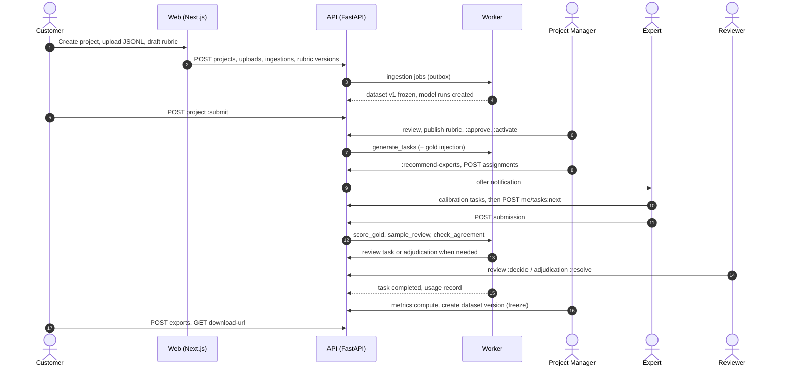

# Component Design

> **Reconciliation note (2026-10-20):** Where this document differs from `planning/architecture_decisions.md`, the ADRs there are authoritative. In particular: Phase 1 authentication is FastAPI-native with MFA for every account (ADR-005), Langfuse and model connectors are Phase 3 (ADR-007), enterprise SSO is Phase 4, Track B is Phase 5 (ADR-015), and experts get assignment-scoped RLS (ADR-017).

Status: proposed for MVP. Date: 2026-10-20.
Related: [system_architecture.md](system_architecture.md), [database_design.md](database_design.md), [api_design.md](api_design.md), [data_pipeline.md](data_pipeline.md).

---

## 1. Modular monolith layout

One FastAPI codebase, one deployable image, two process types (`api`, `worker`). Modules own their tables and expose a Python service interface; other modules call that interface or react to its events, never its tables or ORM models directly.

```
backend/
  app/
    main.py                     # FastAPI app factory, router registration
    worker.py                   # Procrastinate app, task registration
    core/                       # cross-cutting, no business logic
      config.py  db.py (engine, tenant_session)  security.py (JWT/JWKS, API keys)
      authz.py (require(), permission registry)  errors.py (problem+json)
      idempotency.py  pagination.py  ratelimit.py  storage.py (S3 adapter)
      jobs.py (enqueue facade)  outbox.py  audit.py  telemetry.py (OTel)
    modules/
      identity/  orgs/  experts/  projects/  rubrics/  ingestion/  datasets/
      tasks/  evaluation/  qa/  metrics/  exports/  billing/  audit/
      notifications/  integrations/  platform/
        each module:
          api.py        # routers (thin: parse, authorize, call service)
          service.py    # use cases, transactions, state transitions
          models.py     # SQLAlchemy 2.0 models (module-private)
          schemas.py    # Pydantic v2 request/response models (public contract)
          events.py     # event payload types emitted/consumed
          jobs.py       # Procrastinate tasks owned by this module
          interface.py  # the only symbols other modules may import
    lib/
      metrics_math/             # pure functions: alpha, kappa, bootstrap, Bradley-Terry
      exporters/                # Exporter registry and format implementations
      task_types/               # TaskType plugin registry
  migrations/                   # Alembic
  tests/
frontend/                       # Next.js (App Router) + Better Auth
```

Boundary enforcement: `import-linter` contracts in CI (`modules.X` may import only `core`, `lib`, and `modules.Y.interface`). Cross-module reads that would require joins (e.g. dashboards) go through read-model query functions in the owning module or a dedicated `reporting` query layer reading SQL views.

---

## 2. Modules

### 2.1 identity

- Responsibilities: map an authenticated principal (Better Auth JWT or API key) to `users`, active memberships, roles, expert profile, staffed projects; issue the `RequestContext` used by authz and RLS.
- Key components: `JwksVerifier` (caches Better Auth JWKS, refetch on unknown `kid`), `ApiKeyAuthenticator` (prefix lookup + constant-time hash compare), `ContextResolver`.
- Tables: `users`, `api_keys` (Better Auth owns `auth.*`).
- Notes: user provisioning hook: when Better Auth creates a user, Next.js calls `POST /v1/internal/users:sync` (service-to-service token) to create `app.users`; idempotent on id.

### 2.2 orgs

- Signup creates org (`pending_verification`), first `customer_admin` membership; domain verification (DNS TXT or email domain) and manual KYC by an internal admin move it to `active`.
- Invitations, member role changes, API keys, org settings (data region, blind identity defaults, PII policy).
- Tables: `organizations`, `memberships`, `roles`, `permissions`, `role_permissions`.

### 2.3 experts

- Expert onboarding (application, credential upload, vetting checklist, interviews outside the system), skills and levels, availability windows, conflict declarations, qualification state per project, rolling quality score.
- Matching service (`recommend(project_id, count)`):
  1. Hard filters: status active; mandatory requirements; languages; verified credential kinds; no active conflict where `subject_org_id = project.org_id` or `subject_domain` in the org's verified domains or `subject_name` fuzzy-matches (pg_trgm similarity >= 0.6, flagged for PM review rather than auto-excluded) an `exclude_company` requirement; not revoked from this project.
  2. Score: weighted sum of skill match (level vs required), credential verification, language bonus, quality history (rolling gold accuracy and acceptance, shrunk toward the prior for new experts), availability in the next 14 days minus current load, and a fairness term that slightly boosts experts with fewer recent offers.
  3. Return explanation per factor (`match_explain`) so PMs can justify choices.
- Algorithm version string stored with each approved assignment for later analysis. Learning-to-rank is a later improvement once outcome data exists.
- Tables: `expert_profiles`, `expert_credentials`, `skills`, `expert_skills`, `expert_availability`, `conflict_declarations`, `expert_qualifications`.

### 2.4 projects

- Project lifecycle and state machine; requirements; staffing (`project_staff`); batches; project quality configuration; SLA tracking.
- Internal review workflow: `submitted` lands in the PM queue; PM checks scope, feasibility, rubric readiness, pricing; `approve` or `request-changes` with comments.
- Tables: `projects`, `project_requirements`, `project_staff`, `task_batches`.

### 2.5 rubrics

- Rubric library per org; versions with criteria, anchors, scoring config; error taxonomies with hierarchical labels; publish with content hash; diff between versions; templates owned by the platform org are cloned into the customer org on use (a rubric always belongs to the org whose data it scores, so FKs and RLS stay simple).
- Tables: `rubrics`, `rubric_versions`, `rubric_criteria`, `error_taxonomies`, `error_taxonomy_labels`.

### 2.6 ingestion

- Upload orchestration (presign, complete, scan), ingestion jobs (validate, import), connectors (API batch, Langfuse later). Owns the parsing/validation code and error reports.
- Tables: `ingestion_jobs`; uses `stored_objects` via `core.storage`.

### 2.7 datasets

- Datasets, versions, items, membership, manifests, diffs, model runs and outputs; curation (build a new version from project results).
- Tables: `datasets`, `dataset_versions`, `dataset_items`, `dataset_version_items`, `model_runs`, `model_outputs`, `stored_objects` (shared metadata table owned by this module's storage sub-package).

### 2.8 tasks

- Task generation, gold injection, pool and direct assignment, leases and expiry, task state machine, presentation-order randomisation, "next task" allocation.
- Tables: `evaluation_tasks`, `evaluation_task_outputs`, `task_assignments`.

### 2.9 evaluation

- Expert workbench back end: task payload assembly through the `TaskType` plugin, draft autosave, submission validation against rubric version and task type, persistence of scores, error labels, corrections, preferences, rankings, red-team items.
- Tables: `evaluation_submissions`, `scores`, `submission_error_labels`, `preference_judgments`, `corrected_outputs`, `red_team_items`.

### 2.10 qa

- Gold management and calibration rounds, review sampling, review queue and decisions, rework loop, agreement check per task, adjudication queue and resolution, feedback to experts.
- Tables: `gold_items`, `review_tasks`, `adjudications`; updates `expert_qualifications` through the experts interface.

### 2.11 metrics

- Project, criterion, expert and model-run metrics; model comparison and regression detection; dashboard read models.
- Pure math lives in `lib/metrics_math` with property-based tests (Hypothesis) and fixtures cross-checked with reference implementations.
- Tables: `metric_runs`, `quality_metrics`.

### 2.12 exports (datasets/exports)

- Exporter registry, export jobs, deliverables, download URLs, data cards.
- Tables: `exports`, `deliverables`.

### 2.13 billing

- Usage metering from events, rate cards, rating, invoice drafting, GST details, invoice PDFs (WeasyPrint), customer usage dashboard. Expert payout ledger in phase 2.
- Tables: `rate_cards`, `usage_records`, `invoices`, `invoice_line_items`.

### 2.14 audit

- `core.audit.record(action, target, changes)` writes to the outbox in the request transaction; the single-writer consumer appends to `audit.audit_events` with hash chaining; read API for org admins; nightly chain verification and anchoring.
- What is audited: auth events (from Better Auth hooks), membership/role changes, project state transitions, rubric publish, assignment approvals/revocations, submissions (metadata only), review/adjudication decisions, dataset freeze, export creation and every download URL issuance, data access by platform staff, impersonation start/stop, billing changes, settings changes.

### 2.15 notifications

- In-app notifications table, email via Amazon SES (templates in repo, MJML or React Email rendered by the web tier), digest batching for experts (max one offer email per hour), webhook delivery with signing and retries.
- Tables: `notifications`, `webhook_endpoints`, `webhook_deliveries`.

### 2.16 integrations

- Customer connections: Langfuse (import traces/datasets, push scores), OpenAI-compatible endpoints (phase 3: platform calls the customer model to generate outputs for new model versions, with customer-provided keys in Secrets Manager), customer S3 bucket delivery (phase 4).
- Optional internal Langfuse: tracing of any LLM-assisted features (e.g. AI pre-screening of submissions, rubric drafting assistant) when those are added; not required for MVP.
- Table: `integration_connections`.

### 2.17 platform

- Superadmin and operator tooling: org list, suspend/close, impersonation (time-boxed session, banner, customer-visible audit), feature flags, maintenance mode, job dashboard (SQL over Procrastinate tables).

---

## 3. Front end (Next.js)

App Router, TypeScript, server components by default, TanStack Query for client-side mutations, shadcn/ui + Tailwind, react-hook-form + zod (zod schemas generated from OpenAPI for parity with server validation).

Route groups (one app, role-aware navigation):

| Area | Users | Key screens |
|---|---|---|
| `/(customer)` | customer_admin, customer_member | org setup, projects list/wizard, upload and mapping, rubric editor with preview, dashboard (progress, agreement, model comparison), deliverables and exports, usage and invoices, API keys, audit log |
| `/(expert)` | expert | onboarding, profile/credentials/availability/conflicts, task inbox, workbench (side-by-side outputs, rubric panel with anchors, span highlighting for error labels, correction editor with diff, pairwise/ranking widgets, timer, autosave), feedback, earnings |
| `/(staff)` | PM, reviewer, internal_org_admin | project intake queue, recommendations and approvals, staffing, review queue, adjudication workbench (all submissions side by side, agreement heat map), gold management, expert vetting, quality dashboards |
| `/(platform)` | platform_operator, superadmin | orgs, impersonation, job monitor, feature flags |

Auth in the web tier: Better Auth (email + password with breached-password check, email OTP/magic link, Google and Microsoft OAuth, TOTP 2FA mandatory for staff and reviewers, organization plugin not used for authorization (FastAPI owns memberships), JWT plugin for API calls, SSO plugin for enterprise OIDC/SAML in phase 4).

The workbench must be robust for long sessions: autosave every 10 s and on blur, offline-tolerant draft queue in IndexedDB, lease heartbeat every 60 s, conflict warning if the same assignment is open in two tabs.

---

## 4. Cross-cutting components

| Component | Design |
|---|---|
| `tenant_session()` | async context manager: opens transaction, `SET LOCAL app.*`, yields session; used by every request and job |
| `require()` authz | declarative permission + relationship check; permissions are a static registry seeded into `permissions` by migration; a unit test asserts every route declares a permission |
| Idempotency | middleware storing (principal, key, route, body hash, response) in `app.idempotency_keys` (UNLOGGED not used: must survive restarts) with 24 h TTL |
| Problem details | exception handlers map domain errors (`InvalidStateTransition`, `NotFound`, `ConflictOfInterest`) to RFC 9457 responses |
| Telemetry | OpenTelemetry SDK (FastAPI, SQLAlchemy, httpx, botocore instrumentation), trace ids in logs (structlog JSON), Sentry for errors |
| Feature flags | table-backed flags per org (no third-party SaaS in MVP) |
| Config | pydantic-settings; secrets from AWS Secrets Manager injected as env by ECS |

---

## 5. Key sequences

### 5.1 Project to delivery (happy path)



### 5.2 Submission transaction boundaries

1. Request transaction: validate, insert submission tree, update assignment and task counters, outbox `submission.submitted`, audit entry. Commit.
2. Relay defers `score_gold`, `sample_review`, `check_agreement` (if overlap reached), `meter_expert_minutes`.
3. Each job runs in its own `tenant_session(org_id)`, idempotent on (event id, job name).

---

## 6. Testing strategy per module

- Unit: services with a real Postgres (testcontainers) rather than mocks, because constraints and RLS are part of the behaviour.
- RLS suite: for every tenant table, seed two orgs and assert cross-org reads/writes fail under `app_rw`.
- Contract: OpenAPI snapshot diff in CI; generated TS client compiled by the web build.
- Metrics math: reference fixtures and Hypothesis properties (alpha = 1 for identical annotations, invariance to annotator relabeling).
- Workflow: end-to-end scenario tests (project -> ingestion -> tasks -> submissions with disagreement -> adjudication -> export) on docker-compose in CI.
- UI: Playwright for the expert workbench and project wizard.
