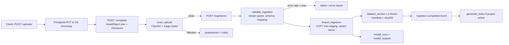

# Data Pipeline

> **Reconciliation note (2026-10-20):** Where this document differs from `planning/architecture_decisions.md`, the ADRs there are authoritative. In particular: Phase 1 authentication is FastAPI-native with MFA for every account (ADR-005), Langfuse and model connectors are Phase 3 (ADR-007), enterprise SSO is Phase 4, Track B is Phase 5 (ADR-015), and experts get assignment-scoped RLS (ADR-017).

Status: proposed for MVP. Date: 2026-10-20.
Covers ingestion, task generation, assignment flow, metrics, dataset versioning, exports, storage layout, background jobs and events, and Track B extension.
Related: [database_design.md](database_design.md), [api_design.md](api_design.md), [diagrams/workflow.mmd](diagrams/workflow.mmd).

---

## 1. Job and event backbone

### 1.1 Choice: Procrastinate (PostgreSQL-backed queue) + transactional outbox

| Option | Pros | Cons | Verdict |
|---|---|---|---|
| Celery + Redis | Mature, huge ecosystem, Flower UI | Extra stateful infra (Redis), at-least-once with visibility-timeout quirks, enqueue is not transactional with Postgres writes, weak typing, async story weak | Not for MVP |
| RQ | Very simple | Redis only, sync only, limited scheduling and retries | No |
| Dramatiq | Clean API, good retries, Redis or RabbitMQ | Still a second datastore; no transactional enqueue | Viable runner-up |
| arq | asyncio native, light | Redis only; small maintainer base | No |
| Procrastinate | Jobs live in Postgres (PG 13+, Python 3.10+), sync and async, retries with strategies, periodic tasks, task locks and queueing locks, Django-independent; no new datastore; jobs inspectable with SQL and backed up with the DB | Throughput ceiling lower than Redis brokers (fine for thousands of jobs/min); polling/notify load on primary DB | **Chosen** |
| PgQueuer | Postgres, LISTEN/NOTIFY, SKIP LOCKED, cron, batching | Younger API with breaking import changes between versions | Alternative if Procrastinate stalls |
| Temporal | Durable long-running workflows, timers, versioning, great visibility | Separate cluster (or Temporal Cloud, data leaves India unless self-hosted), steep learning curve, overkill for MVP flows | Revisit for Track B media pipelines or multi-day SLA workflows |

Rationale: MVP job volumes are modest (ingestion of up to millions of rows per day, tens of thousands of submissions per day). Keeping jobs in the same Postgres gives backups, RLS-aware debugging and one fewer moving part. The queue is wrapped behind a small `jobs` interface (`enqueue(name, payload, *, queue, lock, schedule_at)`) so a move to Dramatiq or Temporal is contained.

Verified (docs, Oct 2026): Procrastinate requires PostgreSQL 13+ and Python 3.10+, supports async workers (`defer_async`, `run_worker_async`), per-task retry strategies, periodic tasks and task locks. PgQueuer uses `FOR UPDATE SKIP LOCKED`, LISTEN/NOTIFY and cron-style schedules.

### 1.2 Transactional outbox

Domain writes and the events they cause are committed atomically:

1. Service writes domain rows and inserts into `app.outbox_events` in the same transaction.
2. `outbox_relay` (a Procrastinate periodic task every 2 s, plus `NOTIFY` wake-up) reads undispatched rows with `FOR UPDATE SKIP LOCKED`, fans each event out to its subscribers by deferring Procrastinate jobs, writes audit events, and sets `dispatched_at`.
3. Handlers are idempotent (keyed on `outbox_events.id`), because delivery is at-least-once.

This decouples modules (e.g. `evaluation` emits `submission.submitted`; `qa`, `metrics`, `billing`, `notifications` subscribe) without a message broker.

### 1.3 Queues and workers

| Queue | Jobs | Concurrency (prod start) |
|---|---|---|
| `default` | outbox relay fan-out, notifications, webhooks, small state updates | 16 async |
| `ingest` | `scan_upload`, `validate_ingestion`, `import_ingestion`, `generate_tasks` | 4 (memory bound) |
| `quality` | `score_gold`, `sample_review`, `check_agreement`, `compute_metrics` | 4 |
| `export` | `build_dataset_version`, `run_export` | 2 |
| `billing` | `rate_usage`, `close_invoice_period` | 1 |
| `maintenance` | lease expiry, janitor, partition creation, audit chain verify, expert quality rollup | 1 |
| `media` (Track B) | transcode, frame extraction, segmentation | separate GPU/CPU worker service |

### 1.4 Event catalogue

| Event | Emitted by | Subscribers |
|---|---|---|
| `org.created`, `org.verified` | orgs | notifications, billing (create customer) |
| `project.submitted` | projects | notifications (PM queue) |
| `project.approved`, `project.activated` | projects | tasks (`generate_tasks`), notifications |
| `upload.completed` | storage | ingestion (`scan_upload`) |
| `ingestion.completed` | ingestion | tasks (if project active), webhooks, notifications |
| `rubric_version.published` | rubrics | tasks (optional migration offer), audit |
| `assignment.approved`, `assignment.offered` | tasks | notifications (expert email/in-app) |
| `submission.submitted` | evaluation | qa (`score_gold`, `sample_review`), tasks (`check_agreement` when overlap reached), billing (expert minutes), metrics (incremental) |
| `review.decided` | qa | tasks (state), notifications (expert feedback), metrics |
| `adjudication.resolved` | qa | tasks (complete), metrics, notifications |
| `task.completed` | tasks | billing (`task_completed` usage), metrics |
| `dataset_version.frozen` | datasets | webhooks, notifications |
| `export.succeeded` / `export.failed` | exports | webhooks, notifications, billing |
| `metrics.computed` | metrics | dashboards cache bust, regression alerts |

### 1.5 Periodic jobs

| Job | Schedule |
|---|---|
| `expire_assignment_leases` | every 5 min: `accepted/in_progress` past `lease_expires_at` -> `released`, task slot reopened |
| `offer_expiry` | every 15 min: `offered` > 24 h -> `expired` |
| `compute_metrics_active_projects` | hourly for active projects (skipped when `inputs_sha256` unchanged) |
| `expert_quality_rollup` | nightly: rolling 30-day gold accuracy, review acceptance, agreement with consensus -> `expert_profiles.rolling_quality_score`, tier proposals |
| `rate_usage` | hourly: attach rate card prices to unrated `usage_records` |
| `close_invoice_period` | monthly on the 1st (IST): draft invoices per org |
| `storage_usage_snapshot` | daily: `storage_gb_month` usage |
| `janitor_pending_uploads` | hourly |
| `create_audit_partitions` | daily: ensure 3 months ahead |
| `verify_audit_chain` | nightly: verify and anchor head hash to Object Lock bucket |
| `export_expiry` | daily: mark expired exports, delete objects |

---

## 2. Ingestion pipeline



Steps:

1. **Upload**: presigned PUT to `incoming/` prefix (see section 9). Size cap 2 GiB MVP. Multipart above 100 MiB.
2. **Scan**: ClamAV sidecar in the worker (signature DB refreshed daily); magic-byte sniffing must agree with declared content type; CSV/JSONL must be UTF-8 (BOM stripped); reject zip bombs by disallowing archives in MVP.
3. **Validate** (streaming, constant memory):
   - CSV parsed with Python `csv` in streaming mode (Polars lazy scan for large files); JSONL line by line with `orjson`.
   - Mapping applied (restricted JSONPath subset: `$.a.b`, `$.a[0]`, no filters).
   - Per-row checks: `external_id` present and unique within file; prompt non-empty, <= 256 KB inline (larger offloaded to `item_payload` objects); messages roles in {system,user,assistant,tool}; language tag valid; model outputs present for every declared run (or row marked partial).
   - PII and secret detection (optional per project): regex + Presidio-style detectors flag rows; customers choose `flag` or `reject`. Flags stored in `dataset_items.metadata.pii_flags`.
   - Error report written as JSONL `{row, external_id, code, message}` to `orgs/{org}/ingestions/{id}/errors.jsonl`.
4. **Import**:
   - `COPY` rows into an `UNLOGGED` staging table scoped by ingestion id, then set-based upsert into `dataset_items` (`ON CONFLICT (dataset_id, external_id, content_sha256) DO NOTHING`), `dataset_version_items`, `model_runs`, `model_outputs`.
   - Content hash: sha256 over canonical JSON (sorted keys, NFC-normalised strings, no insignificant whitespace) of `{prompt, reference_answer, metadata}`.
   - New dataset version is created with `parent_version_id` = latest frozen version and `source = 'upload'`; an append ingestion copies parent membership then adds new rows; a replace ingestion starts empty.
   - Manifest written (section 6) and version frozen.
   - Batches of 5,000 rows per transaction; progress counters updated per batch; job is resumable from the last committed batch.
5. **Emit** `ingestion.completed`.

API connector path (`source_type = api_batch`): items arrive inline in requests (max 1,000 per call); they are written to a staging object and go through the same validate/import jobs, so there is exactly one import code path.

Langfuse connector (optional, phase 3): pulls traces or dataset runs through Langfuse's public API using a customer-provided key held in Secrets Manager; maps trace input/output to prompt/model output; can push final scores back to Langfuse as scores keyed by trace id.

---

## 3. Task generation

Triggered by `project.activated`, `ingestion.completed` on an active project, or a PM "release batch" action.

Algorithm (`generate_tasks(project_id, dataset_version_id, batch_id)`):

1. Load project config (`task_type`, `overlap_k`, `gold_rate`, current published rubric version). Abort if no published rubric.
2. For each item in the dataset version (streamed in pages of 2,000):
   - Determine outputs to show: `rubric_scoring` / `sft_correction`: one task per (item, model_output) or per item with all outputs as slots (project setting); `pairwise_preference`: one task per (item, pair of runs) with slots A/B; `ranking`: all outputs as slots A..H; `red_team`: one task per seed prompt or open "generate N attacks" task.
   - `generation_key = sha256(project_id, item_id, rubric_version_id, sorted(model_output_ids))`; insert with `ON CONFLICT (project_id, generation_key) DO NOTHING`, so re-running is safe.
   - Slot order is stored canonically; the per-assignment presentation order is randomised at read time with a seed derived from `assignment_id`, recorded in `client_meta`, so position bias can be measured.
3. Inject gold: active `gold_items` with purpose `hidden_qa` are added as tasks with `is_gold = true` at a rate of `gold_rate`, distributed uniformly across the batch so every expert sees roughly the same proportion.
4. Set task status `ready`, `required_overlap = overlap_k` (gold tasks use 1 per expert but are served to many experts).
5. Emit `tasks.generated` with counts; notify PM.

Assignment flow (pool mode, the MVP default):

```
expert -> POST /me/tasks:next?project_id=P
  BEGIN
    verify expert approved for P and qualified (or route to calibration tasks)
    verify open assignments < max_concurrent_tasks and project max_tasks for expert
    SELECT t.id FROM evaluation_tasks t
     WHERE t.project_id = P AND t.status IN ('ready','in_progress')
       AND (SELECT count(*) FROM task_assignments a WHERE a.task_id = t.id
            AND a.status NOT IN ('declined','expired','released','revoked')) < t.required_overlap
       AND NOT EXISTS (SELECT 1 FROM task_assignments a WHERE a.task_id = t.id AND a.expert_id = :me)
     ORDER BY t.priority, t.id
     FOR UPDATE SKIP LOCKED LIMIT 1
    INSERT task_assignments(status='accepted', approved_by=<pool approval>, lease_expires_at=now()+interval '2 hours')
    UPDATE evaluation_tasks SET status='in_progress'
  COMMIT
```

The count subquery is acceptable at MVP scale; if it becomes hot, add a maintained `live_assignment_count` column updated in the same transaction.

---

## 4. Quality pipeline

### 4.1 On each submission (`submission.submitted`)

1. **Gold scoring** (`score_gold`) if task `is_gold` or `is_calibration`: compare against `expected_result` with `tolerance`; record pass/fail into `quality_metrics` (scope `expert`, metric `gold_accuracy`, rolling), and for calibration update `expert_qualifications` (qualified when >= 80% within tolerance over >= 10 items, configurable). Gold failures with critical misses create a `review_tasks` row (`reason = gold_fail`).
2. **Review sampling** (`sample_review`): create `second_review` with probability `second_review_rate`, raised to 1.0 for the expert's first 20 submissions on a project (`new_expert`), for `too_fast` flags, and for low self-reported confidence. Sampling uses a deterministic hash of `submission_id` so it is reproducible.
3. **Agreement check** (`check_agreement`) when the task has `required_overlap` submitted, non-rejected submissions:
   - Compute per-task agreement per criterion (ordinal: max pairwise distance and mean absolute deviation; binary/categorical: majority share; pairwise: preference agreement share).
   - If every required criterion meets `projects.agreement_threshold` (as share agreeing within tolerance), resolve `final_result` by aggregation rule (median for ordinal, majority for categorical, majority preference with strength mean) and set task `completed`, `final_source = 'consensus'`.
   - Otherwise open an `adjudications` row (`trigger = low_agreement`) and set task `in_adjudication`.
   - With `overlap_k = 1`, the single submission becomes final after its sampled review (if any) is accepted, `final_source = 'single'` or `'review'`.

### 4.2 Project-level metrics (`compute_metrics`)

Implemented in a pure-Python `metrics` package (NumPy/SciPy; `krippendorff` package for alpha) with unit tests against published reference values.

| Metric | Use | Notes |
|---|---|---|
| Krippendorff's alpha (nominal/ordinal/interval) | primary inter-annotator agreement per criterion | handles missing data and variable annotator counts, which matches pool assignment |
| Fleiss' kappa | categorical labels with fixed k | reported for comparability |
| Cohen's kappa | expert vs adjudicated final, expert vs gold | per-expert quality |
| Percent agreement | dashboards, intuitive | always shown next to chance-corrected metrics |
| Gold accuracy | per expert, per project | rolling 30 days |
| Review acceptance / rework rate | per expert, per project | |
| Mean score per criterion per model run | eval results | bootstrap 95% CI (1,000 resamples over items) |
| Win/tie rate, Bradley-Terry or Elo | pairwise and ranking comparisons | CIs by bootstrap over items |
| Score delta and regression flag | candidate vs baseline run | flag when CI of delta excludes 0 in the harmful direction and abs(delta) >= configured minimum |
| Throughput, median handling time | ops | |

Results are written as one `metric_runs` row plus many `quality_metrics` rows; dashboards read the latest successful run. `inputs_sha256` over the sorted submission id set lets the hourly job skip unchanged projects.

### 4.3 Ongoing evaluation of new model versions

1. Customer uploads (or pushes via API) outputs of a new model version against an existing **frozen benchmark dataset version**, creating a `model_runs` row with `baseline_run_id`.
2. `generate_tasks` creates pairwise (candidate vs baseline) and/or rubric tasks only for the new outputs; previously completed baseline judgements are reused where the rubric version is unchanged.
3. Metrics job runs `model_comparison`; regression flags produce a `metrics.computed` event with `regressions[]`, sent to dashboards and webhooks.
4. A rubric change between runs breaks comparability; the comparison endpoint refuses to compare runs scored on different rubric versions unless `allow_cross_version=true`, in which case only shared unchanged criteria (same key and same anchors hash) are compared.

---

## 5. Rework and adjudication loop

```
submission -> review(request_rework) -> assignment in_progress, task rework
           -> expert resubmits revision n+1 (previous -> superseded)
           -> rework_review (always 100%) -> accept | reject (slot reopened for another expert)
adjudication -> senior reviewer resolves -> final_result, task completed
             -> per-expert feedback notifications
             -> disagreement cases with clear rationale become candidate gold items (PM approves)
```

Max rework cycles per assignment: 2 (then `reject` and reassign). All transitions emit events and audit records.

---

## 6. Dataset versioning and provenance

Model: content-addressed items (`dataset_items`) plus immutable version membership (`dataset_version_items`). A version is a set of item ids with positions and splits; versions share unchanged items, so storage grows with changes, not with versions.

Freezing a version:

1. Build ordered membership.
2. Write `manifest.json` to object storage:

```json
{
  "dataset_id": "0192f0d0-...", "version": 2, "parent_version": 1,
  "created_at": "2026-10-20T11:00:00Z", "item_count": 1180,
  "items_digest": "sha256 over the ordered list of item content hashes",
  "splits": { "test": 1180 },
  "provenance": {
    "source": "curation",
    "project_id": "0192f0a1-...",
    "rubric_versions": [{ "id": "0192f101-...", "version": 3, "content_sha256": "b194..." }],
    "error_taxonomy": { "id": "0192f0ff-...", "version": 2 },
    "model_runs": [{ "id": "0192f0d5-...", "label": "prod-2026-10" }],
    "filters": { "task_status": ["completed"], "min_agreement": 0.6, "exclude_gold": true },
    "quality_snapshot": { "metric_run_id": "0192f400-...", "alpha_accuracy": 0.74, "gold_accuracy": 0.93 },
    "annotation_counts": { "submissions": 3540, "experts": 14, "adjudicated": 97 },
    "code_version": "git:4e1c2ab",
    "export_schema_version": "1.0"
  }
}
```

3. Store `manifest_sha256` in `dataset_versions`, set `frozen`. Triggers then forbid changes.
4. Diff endpoint: added/removed/changed items between versions by set difference on item ids and external ids.

Per-item provenance in exports: every exported row carries `item_id`, `external_id`, `dataset_version`, `rubric_version`, `final_source`, number of annotators, agreement, and pseudonymous annotator ids (opt-in), so a customer can trace any label back to its evidence.

---

## 7. Exports

| Deliverable | Format id | Valid for task types | Row shape (JSONL) |
|---|---|---|---|
| Eval benchmark | `eval_benchmark_jsonl` | rubric_scoring, classification, freeform_review | `{"id","prompt","reference_answer","rubric":{"version","criteria"},"labels":{"accuracy":2,...},"error_labels":[...],"agreement":{...},"provenance":{...}}` |
| SFT | `sft_jsonl` | sft_correction (and rubric_scoring with corrections) | `{"messages":[...prompt..., {"role":"assistant","content":"<corrected>"}],"metadata":{...}}` (OpenAI/HF chat format) |
| Preference pairs | `preference_pairs_jsonl` | pairwise_preference, ranking (expanded to pairs) | `{"prompt":[...],"chosen":[...],"rejected":[...],"strength":2,"rationale":"...","metadata":{...}}` (TRL DPO-compatible) |
| Red-team set | `red_team_jsonl` | red_team | `{"prompt","attack_category","technique","expected_safe_behavior","observed_output","succeeded","severity"}` |
| Tabular | `csv`, `parquet` | all | flattened; Parquet via PyArrow |
| Track B | `lerobot`, `rlds`, `hdf5` | capture | adapters, phase 5 |

Export job (`run_export`):

1. Load frozen version and per-format options (validated against a JSON Schema per format).
2. Stream rows from Postgres with a server-side cursor (`yield_per(5000)`), transform via a registered `Exporter` class (`format_id`, `options_schema`, `supports(task_type)`, `write(rows, sink)`).
3. Write to a local temp file with gzip, then multipart upload to `orgs/{org}/exports/{export_id}/`; compute sha256 while streaming.
4. Also write `README.md` (data card: schema, provenance summary, licence/usage terms, metric snapshot) and `manifest.json` into the same prefix; bundle as tar.gz when more than one file.
5. `stored_objects` row + `exports.status = succeeded`, `expires_at = now() + 30 days`; usage record `export_generated`; event `export.succeeded`.

Exports are deterministic for a given (version, format, options, export_schema_version), so expired artifacts can be regenerated byte-for-byte.

---

## 8. Billing data flow

- Usage records are emitted from events with idempotency keys (`task_completed:<task_id>`, `review_completed:<review_id>`, `export_generated:<export_id>`), so replays never double-bill.
- Hourly rating applies the effective `rate_cards` row (project-specific overrides org default).
- Monthly invoice drafting groups unbilled usage per org and project into `invoice_line_items`, computes GST (CGST+SGST intra-state, IGST inter-state, export of services zero-rated with LUT for foreign customers; tax logic is reviewed by finance before launch), and assigns sequential Indian FY numbers.
- MVP: invoices issued manually after finance review; payment collection (Razorpay/Stripe) and expert payouts (RazorpayX or bank file) are phase 2. `expert_minutes` usage doubles as payout basis.

---

## 9. Object storage layout and presigned URLs

Buckets (per environment, per region):

| Bucket | Purpose | Settings |
|---|---|---|
| `infollion-{env}-data-aps1` | all tenant data | SSE-KMS (per-env CMK), versioning on, Block Public Access, TLS-only bucket policy, lifecycle rules below |
| `infollion-{env}-audit-aps1` | audit chain anchors, audit archive | Object Lock compliance mode, 7-year retention |
| `infollion-{env}-backup-aps2` | cross-region copies (prod only) | replication target in ap-south-2 (Hyderabad) |

Key layout in the data bucket:

```
orgs/{org_id}/incoming/{upload_id}                              # raw uploads, lifecycle 30 d
orgs/{org_id}/ingestions/{ingestion_id}/errors.jsonl
orgs/{org_id}/datasets/{dataset_id}/items/{sha256[0:2]}/{sha256}.json   # payloads > 256 KB
orgs/{org_id}/datasets/{dataset_id}/versions/{version}/manifest.json
orgs/{org_id}/exports/{export_id}/{filename}                     # lifecycle 30 d after expires_at
orgs/{org_id}/invoices/{invoice_id}.pdf
platform/experts/{expert_id}/credentials/{object_id}             # platform org data
platform/consents/{consent_id}/evidence
orgs/{org_id}/captures/{session_id}/{stream_id}/...              # Track B
```

Rules:
- `org_id` is the first path component so per-tenant deletion, replication filters, and S3 Storage Lens reporting are trivial.
- Optional per-org KMS keys for enterprise customers (key ARN in `organizations.settings`), enabling crypto-shredding on contract termination.
- Presigned PUT: 15 min TTL, exact `Content-Type` and `x-amz-checksum-sha256` signed in, content-length enforced at completion via HeadObject.
- Presigned GET: 5 min TTL, `response-content-disposition=attachment`, issued only after a permission check, audited.
- Workers access S3 via the task IAM role; the browser never gets long-lived credentials.
- MinIO locally with identical bucket names and keys; the storage adapter uses boto3 with `endpoint_url` override, nothing MinIO-specific.

---

## 10. Track B extension (physical AI capture), design only

What is reused unchanged: orgs, projects, consent, stored_objects, datasets/versions (item = episode), tasks (segmentation and labelling tasks), review/adjudication, metrics framework, exports registry, billing meters (`capture_minutes`).

Extension points defined now:

1. **Item schema registry**: `datasets.item_schema` plus a Python registry mapping schema id to a Pydantic model and validator. `capture_episode` items reference streams by object id rather than inline content.
2. **Task type plugins**: each task type registers (a) payload builder for the expert UI, (b) submission schema, (c) agreement function, (d) export transformers. Track B adds `video_segmentation`, `action_labeling`, `success_judgment`.
3. **Exporter registry**: `lerobot` (LeRobotDataset layout: Parquet episode data + MP4 video + `meta/info.json`), `rlds` (TFDS/RLDS episodes of steps), `hdf5` (one group per episode, datasets per modality, attributes for calibration). Implemented in the separate `media` worker image so heavy dependencies (ffmpeg, PyAV, TensorFlow Datasets, h5py) do not bloat the API image.
4. **Media upload path**: S3 multipart from a capture client with resumable uploads (up to tens of GB per session), checksums per part, consent check before upload URL issuance (a capture session cannot be created without an active `capture_recording` consent for every participant).
5. **Media processing workflow**: transcode to standard codecs, generate proxies and thumbnails, extract timestamps and align sensor streams, optional face/plate blurring before experts see footage. Multi-step, long-running and retry-heavy; this is where Temporal becomes justified (ADR candidate).
6. **Storage tiering**: raw capture to S3 Intelligent-Tiering/Glacier Instant Retrieval after 30 days; proxies stay in Standard.
