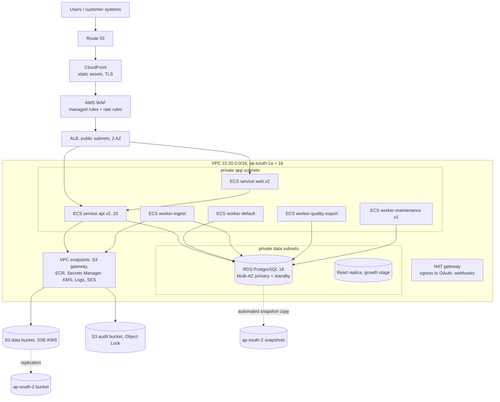
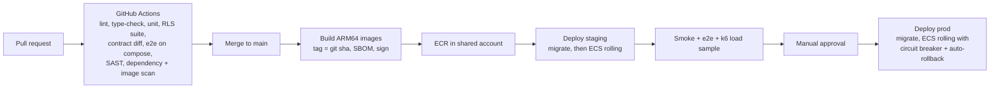

# Deployment Architecture

> **Reconciliation note (2026-10-20):** Where this document differs from `planning/architecture_decisions.md`, the ADRs there are authoritative. In particular: Phase 1 authentication is FastAPI-native with MFA for every account (ADR-005), Langfuse and model connectors are Phase 3 (ADR-007), enterprise SSO is Phase 4, Track B is Phase 5 (ADR-015), and experts get assignment-scoped RLS (ADR-017).

Status: proposed for MVP. Date: 2026-10-20.
Related: [system_architecture.md](system_architecture.md), [data_pipeline.md](data_pipeline.md), security controls in `security_architecture.md` (security agent).

---

## 1. Environments

| Env | Purpose | Infra | Data |
|---|---|---|---|
| local | developer machines | docker-compose | synthetic seed data |
| ci | per-PR test runs | GitHub Actions + service containers | ephemeral |
| preview (optional) | per-PR UI review | Vercel-like preview not used; single shared `dev` stack instead | synthetic |
| staging | release candidate, UAT, load tests | AWS ap-south-1, separate account | synthetic + anonymised fixtures, never real customer data |
| production | customers | AWS ap-south-1 (primary), ap-south-2 (DR), separate account | real |

AWS Organizations with separate accounts: `shared` (ECR, CI OIDC roles, DNS), `staging`, `prod`, `logs-archive`, `security` (GuardDuty/Security Hub delegated admin). Account separation is the main blast-radius control.

---

## 2. Local development (docker-compose)

```yaml
# docker-compose.yml (abridged)
services:
  postgres:
    image: postgres:18
    environment: { POSTGRES_DB: infollion, POSTGRES_USER: app_owner, POSTGRES_PASSWORD: dev }
    ports: ["5432:5432"]
    volumes: [pgdata:/var/lib/postgresql/data, ./ops/db/init:/docker-entrypoint-initdb.d]   # creates app_rw, app_platform roles
  minio:
    image: minio/minio:<pinned tag>
    command: server /data --console-address ":9001"
    ports: ["9000:9000", "9001:9001"]
  minio-init:
    image: minio/mc:<pinned tag>
    depends_on: [minio]
    entrypoint: ["/bin/sh","-c","mc alias set l http://minio:9000 minio minio123 && mc mb -p l/infollion-local-data-aps1 l/infollion-local-audit-aps1"]
  mailpit:
    image: axllent/mailpit:<pinned tag>       # SMTP sink replacing SES locally
    ports: ["8025:8025"]
  clamav:
    image: clamav/clamav:<pinned tag>
  api:
    build: ./backend
    command: uvicorn app.main:app --host 0.0.0.0 --port 8000 --reload
    env_file: [./envs.example/api.env]
    depends_on: [postgres, minio]
    ports: ["8000:8000"]
  worker:
    build: ./backend
    command: procrastinate --app=app.worker.app worker --queues=default,ingest,quality,export,billing,maintenance
    env_file: [./envs.example/api.env]
    depends_on: [postgres, minio, clamav]
  web:
    build: ./frontend
    command: pnpm dev
    env_file: [./envs.example/web.env]
    ports: ["3000:3000"]
    depends_on: [api]
  langfuse:                                   # optional profile
    profiles: ["langfuse"]
volumes: { pgdata: {} }
```

Notes:
- `make dev` runs migrations (`alembic upgrade head`), Better Auth migrations, seeds roles/permissions/skills taxonomy and demo orgs/experts.
- The storage adapter only differs by `S3_ENDPOINT_URL`; no MinIO-specific APIs.
- Pin every image tag; Renovate proposes updates.
- Structure of env files lives in `envs.example/`; real values never committed.

---

## 3. Production topology (AWS ap-south-1)



Components:
- **Networking**: VPC across 2 AZs (3 when budget allows), public subnets only for ALB and NAT; app and data subnets private; security groups: ALB -> web/api only; app -> RDS 5432 only; no public RDS.
- **Compute**: ECS Fargate (Graviton/ARM64 images to cut cost about 20%). Services: `web`, `api`, `worker-default`, `worker-ingest`, `worker-quality-export`, `worker-maintenance` (single task: periodic jobs, outbox relay leader). Same backend image with different commands.
- **Database**: RDS for PostgreSQL 18 Multi-AZ, gp3 storage with autoscaling, Performance Insights / Database Insights, `pg_stat_statements`, IAM auth for operators, parameter group with `log_min_duration_statement=500ms`, `idle_in_transaction_session_timeout=60s`, `statement_timeout` per role (api 15 s, workers 10 min).
- **Connections**: SQLAlchemy pool per task (api: 10, workers: 5). RDS Proxy added when total connections exceed about 60% of `max_connections`; transaction pinning avoided by using only `SET LOCAL`.
- **Storage**: S3 as in data_pipeline.md section 9, gateway endpoint so traffic stays off NAT.
- **Email**: SES in ap-south-1 with DKIM/SPF/DMARC on the sending domain.
- **Secrets**: Secrets Manager (DB credentials with rotation, Better Auth secret, JWT signing keys stored by Better Auth in DB encrypted with a KMS-derived key, webhook secrets); injected into ECS tasks as secrets.
- **DNS/TLS**: Route 53, ACM certificates; HSTS.

---

## 4. CI/CD



- GitHub Actions assumes deploy roles via OIDC (no long-lived AWS keys).
- Backend checks: ruff, mypy (strict on `core` and `lib`), pytest with testcontainers Postgres, import-linter, Alembic `upgrade head` + `downgrade -1` + `upgrade head` round trip, RLS coverage test.
- Frontend checks: eslint, tsc, vitest, Playwright against compose stack, OpenAPI client regeneration with no diff.
- Security: Semgrep, pip-audit/npm audit (or OSV-Scanner), Trivy on images, gitleaks; details owned by security agent.
- Infrastructure as code: Terraform (modules: network, ecs-service, rds, s3-bucket, waf), state in S3 with DynamoDB locking in the shared account; `terraform plan` posted on PRs touching `infra/`.

---

## 5. Database migrations

- Alembic, one linear history; migrations reviewed like code.
- Run as a one-off ECS task (`alembic upgrade head`) with the `app_owner` role before the new application version rolls out.
- **Expand / contract** rule: every migration must be compatible with the currently running application version. Renames and type changes are done in steps (add column, dual write, backfill job, switch reads, drop later).
- Lock safety: `SET lock_timeout = '5s'` in every migration; `CREATE INDEX CONCURRENTLY` (in autocommit blocks); add FKs and CHECKs as `NOT VALID` then `VALIDATE CONSTRAINT` separately; large backfills run as batched jobs, not inside migrations.
- Migration helper `enable_tenant_rls(table)` creates the standard policies so new tables cannot miss RLS.
- Better Auth tables (`auth` schema) migrated by its CLI from the web image, in the same pre-deploy step, before the Alembic step.
- Major version upgrades (e.g. PG18 -> PG19): RDS Blue/Green deployment, rehearsed on staging.

---

## 6. Backup and disaster recovery

| Scenario | Mechanism | RPO | RTO |
|---|---|---|---|
| Accidental delete / bad migration | RDS PITR (35-day retention in prod) restore to new instance, selective repair | < 5 min | 1 to 2 h |
| AZ failure | RDS Multi-AZ automatic failover; ECS tasks in 2 AZs | ~0 | 1 to 2 min (DB failover) |
| Region failure (ap-south-1) | Automated cross-region snapshot copy to ap-south-2 (every 1 to 4 h; or AWS Backup with cross-region copy), S3 Cross-Region Replication of data bucket, Terraform able to stand up the stack in ap-south-2, ECR replication | MVP: 4 h (snapshot copy cadence); upgrade path: 5 min with a cross-region read replica | 4 h (target), 8 h (acceptable during MVP) |
| Object deletion / ransomware on S3 | Versioning + MFA delete on audit bucket + Object Lock for audit + replication | 0 | hours |
| Credential compromise | separate accounts, short-lived roles, break-glass procedure (security doc) | n/a | n/a |

Quoted company targets:
- **Tier 1 (database, objects)**: RPO 5 minutes and RTO 4 hours for regional disaster once the cross-region read replica is enabled (planned before the first enterprise contract); during early MVP, RPO 4 hours for regional disaster is accepted and disclosed.
- Restore drills: monthly PITR restore to staging with automated verification (row counts, checksum of a sample of frozen dataset manifests); DR region failover game day twice a year.
- Backups are encrypted with KMS keys that exist in both regions (multi-Region keys) so DR restores do not depend on the failed region.
- Procrastinate jobs live in the database, so a restore also restores the queue state; all jobs are idempotent, which makes replays after restore safe.

---

## 7. Observability

| Signal | Tooling | Key content |
|---|---|---|
| Logs | structlog JSON -> CloudWatch Logs (30 days hot) -> S3 archive (1 year) | request id, trace id, org id, user id, route, status, latency; never payload bodies, prompts, outputs or PII |
| Traces | OpenTelemetry SDK -> ADOT collector sidecar -> X-Ray or Grafana Tempo | FastAPI, SQLAlchemy, botocore, httpx spans; job spans linked to the originating request via trace context in job payload |
| Metrics | CloudWatch + Prometheus-format app metrics via ADOT | RED metrics per route; job queue depth and age per queue (SQL over Procrastinate tables every 30 s); ingestion rows/s; submission rate; review backlog; adjudication backlog; export durations; DB connections, CPU, replica lag |
| Errors | Sentry (EU region or self-hosted if residency demands; PII scrubbing on) | backend and frontend |
| Product health | dashboard: tasks ready vs experts online, SLA burn-down per project, gold accuracy trend | for PMs |
| Uptime | Route 53 health checks / synthetic canaries on login, task fetch, presign | |

Alerts (PagerDuty or Opsgenie, business hours on-call for MVP plus critical 24x7):
- API 5xx rate > 2% for 5 min; p95 > 1 s for 10 min.
- Oldest job in `default` queue > 2 min; `ingest` > 15 min; failed jobs > 10 in 15 min.
- RDS CPU > 80% for 15 min, free storage < 15%, replica lag > 60 s, connections > 80%.
- Audit chain verification failure (critical).
- Backup/snapshot copy job failure.

SLOs: availability 99.5%, submission write success 99.9%, export completion within 30 min for < 1 M rows.

---

## 8. Operations runbooks (to be written before launch)

1. Restore database to point in time.
2. Fail over to ap-south-2.
3. Rotate DB credentials and JWT signing keys.
4. Reprocess failed ingestion / export jobs.
5. Suspend an org; offboard and delete an org's data (export, crypto-shred, purge, certificate of deletion).
6. Respond to an expert data-access incident (revoke assignments, audit query, customer notification).
7. Scale workers for a large project launch.

---

## 9. Configuration by environment

| Setting | local | staging | prod |
|---|---|---|---|
| RDS | postgres:18 container | db.t4g.medium single-AZ | db.r7g.large Multi-AZ |
| API tasks | 1 (reload) | 1 | 2 to 10 autoscaled |
| Workers | 1 combined | 1 combined | 4 services |
| PITR retention | n/a | 7 days | 35 days |
| Cross-region DR | no | no | yes |
| WAF | no | yes (count mode) | yes (block mode) |
| MFA for staff | optional | required | required |
| Log retention | stdout | 14 days | 30 days hot, 1 year archive |
