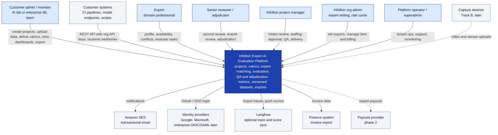

# Architecture diagrams

Open this file and press Cmd+Shift+V to see the rendered diagrams. The source files are the .mmd files in this folder; regenerate this page if they change.

## System context

## Evaluation workflow

```mermaid
flowchart TD
  classDef cust fill:#dbeafe,stroke:#1e40af,color:#0f172a
  classDef staff fill:#fef3c7,stroke:#b45309,color:#0f172a
  classDef expert fill:#dcfce7,stroke:#15803d,color:#0f172a
  classDef sys fill:#f1f5f9,stroke:#475569,color:#0f172a
  classDef decision fill:#fee2e2,stroke:#b91c1c,color:#0f172a

  A["Customer registers org<br/>org pending_verification"]:::cust --> B["Org verified by internal admin"]:::staff
  B --> C["Customer creates project<br/>domain, task type, volume, languages, deadline, format"]:::cust
  C --> D["Upload CSV/JSONL or API batch<br/>presigned S3 upload"]:::cust
  D --> E["Scan, validate, import<br/>dataset v1 frozen, model runs created"]:::sys
  C --> F["Draft rubric version<br/>criteria, anchors, error taxonomy"]:::cust
  E --> G["Submit project for review"]:::cust
  F --> G
  G --> H{"PM review<br/>scope, rubric, feasibility, price"}:::decision
  H -- "changes requested" --> C
  H -- "approved" --> I["PM publishes rubric version<br/>project active"]:::staff
  I --> J["Generate tasks<br/>overlap k, gold injection, slot randomisation"]:::sys
  J --> K["Recommend experts<br/>skills, credentials, language, availability, conflict of interest"]:::sys
  K --> L{"PM approves assignments"}:::decision
  L -- "rejected candidates" --> K
  L -- "approved" --> M{"Expert qualified?"}:::decision
  M -- "no" --> N["Calibration on gold items<br/>feedback shown"]:::expert
  N --> M2{"Pass threshold?"}:::decision
  M2 -- "no" --> X["Not qualified for project"]:::sys
  M2 -- "yes" --> O
  M -- "yes" --> O["Expert pulls next task<br/>scores, labels, explanations,<br/>corrections, preferences, rankings, red-team items"]:::expert
  O --> P["Submission stored<br/>outbox event"]:::sys
  P --> Q["Gold check, review sampling"]:::sys
  Q --> R{"Sampled or flagged?"}:::decision
  R -- "yes" --> S{"Reviewer decision"}:::decision
  S -- "request rework" --> O
  S -- "reject" --> J2["Slot reopened for another expert"]:::sys
  J2 --> O
  S -- "escalate" --> V
  S -- "accept" --> T
  R -- "no" --> T{"Overlap reached?"}:::decision
  T -- "no" --> O
  T -- "yes" --> U{"Agreement above threshold?"}:::decision
  U -- "yes" --> W["Consensus final result<br/>task completed, usage recorded"]:::sys
  U -- "no" --> V["Adjudication by senior reviewer<br/>final result and rationale"]:::staff
  V --> W
  V -. "clear cases become gold candidates" .-> N
  W --> Y["Compute metrics<br/>alpha, kappa, gold accuracy, win rates, regressions"]:::sys
  Y --> Z["Create dataset version<br/>filters, provenance manifest, freeze"]:::staff
  Z --> Z1["Export<br/>eval benchmark, SFT JSONL, preference pairs, red-team set"]:::sys
  Z1 --> Z2["Customer downloads via short-lived signed URL<br/>accepts deliverable"]:::cust
  Z2 --> Z3["New model version uploaded<br/>against frozen benchmark"]:::cust
  Z3 --> J
```

## Database ER diagram

```mermaid
erDiagram
  organizations ||--o{ memberships : has
  users ||--o{ memberships : holds
  roles ||--o{ memberships : grants
  roles ||--o{ role_permissions : includes
  permissions ||--o{ role_permissions : in
  organizations ||--o{ api_keys : issues

  users ||--o| expert_profiles : is
  expert_profiles ||--o{ expert_credentials : has
  expert_profiles ||--o{ expert_skills : has
  skills ||--o{ expert_skills : classifies
  expert_profiles ||--o{ expert_availability : declares
  expert_profiles ||--o{ conflict_declarations : declares
  expert_profiles ||--o{ expert_qualifications : earns

  organizations ||--o{ projects : owns
  projects ||--o{ project_requirements : requires
  projects ||--o{ project_staff : staffed_by
  projects ||--o{ task_batches : groups
  projects ||--o{ expert_qualifications : gates

  organizations ||--o{ rubrics : owns
  projects ||--o{ rubrics : uses
  rubrics ||--o{ rubric_versions : versions
  rubric_versions ||--o{ rubric_criteria : defines
  error_taxonomies ||--o{ error_taxonomy_labels : contains
  error_taxonomies ||--o{ rubric_versions : referenced_by

  organizations ||--o{ stored_objects : stores
  organizations ||--o{ datasets : owns
  datasets ||--o{ dataset_versions : versions
  datasets ||--o{ dataset_items : contains
  dataset_versions ||--o{ dataset_version_items : lists
  dataset_items ||--o{ dataset_version_items : member_of
  projects ||--o{ ingestion_jobs : runs
  ingestion_jobs }o--|| stored_objects : reads

  projects ||--o{ model_runs : evaluates
  dataset_versions ||--o{ model_runs : input_for
  model_runs ||--o{ model_outputs : produces
  dataset_items ||--o{ model_outputs : answered_by

  projects ||--o{ evaluation_tasks : has
  dataset_items ||--o{ evaluation_tasks : evaluated_in
  rubric_versions ||--o{ evaluation_tasks : scored_with
  evaluation_tasks ||--o{ evaluation_task_outputs : shows
  model_outputs ||--o{ evaluation_task_outputs : shown_in
  evaluation_tasks ||--o{ task_assignments : assigned_via
  expert_profiles ||--o{ task_assignments : receives

  task_assignments ||--o{ evaluation_submissions : yields
  evaluation_submissions ||--o{ scores : contains
  rubric_criteria ||--o{ scores : measured_by
  evaluation_submissions ||--o{ submission_error_labels : contains
  error_taxonomy_labels ||--o{ submission_error_labels : applied_as
  evaluation_submissions ||--o| preference_judgments : contains
  evaluation_submissions ||--o{ corrected_outputs : contains
  evaluation_submissions ||--o{ red_team_items : contains

  evaluation_tasks ||--o{ review_tasks : reviewed_in
  evaluation_submissions ||--o{ review_tasks : target_of
  evaluation_tasks ||--o{ adjudications : resolved_by
  projects ||--o{ gold_items : has
  gold_items ||--o{ evaluation_tasks : injected_as

  projects ||--o{ metric_runs : computes
  metric_runs ||--o{ quality_metrics : produces

  projects ||--o{ deliverables : delivers
  dataset_versions ||--o{ deliverables : packaged_as
  dataset_versions ||--o{ exports : exported_as
  exports }o--o| stored_objects : written_to

  organizations ||--o{ consent_records : records
  organizations ||--o{ audit_events : logs
  organizations ||--o{ usage_records : meters
  organizations ||--o{ invoices : billed
  invoices ||--o{ invoice_line_items : itemises
  invoices ||--o{ usage_records : settles
  organizations ||--o{ rate_cards : priced_by

  organizations {
    uuid id PK
    text kind "customer or platform"
    citext slug UK
    text status
    text data_region
  }
  users {
    uuid id PK "equals auth.user.id"
    citext email UK
    bool is_platform_staff
  }
  memberships {
    uuid id PK
    uuid org_id FK
    uuid user_id FK
    uuid role_id FK
    text status
  }
  roles {
    uuid id PK
    text key UK
    text scope
  }
  permissions {
    uuid id PK
    text key UK
  }
  role_permissions {
    uuid role_id PK
    uuid permission_id PK
  }
  api_keys {
    uuid id PK
    uuid org_id FK
    text key_prefix UK
    bytea key_hash
  }
  expert_profiles {
    uuid id PK
    uuid org_id FK "platform org"
    uuid user_id FK
    text pseudonym UK
    text status
    text quality_tier
  }
  expert_credentials {
    uuid id PK
    uuid expert_id FK
    text kind
    text verification_status
  }
  skills {
    uuid id PK
    text key UK
    uuid parent_id FK
  }
  expert_skills {
    uuid expert_id PK
    uuid skill_id PK
    smallint level
  }
  expert_availability {
    uuid id PK
    uuid expert_id FK
    tstzrange period
  }
  conflict_declarations {
    uuid id PK
    uuid expert_id FK
    uuid subject_org_id FK
    text relationship
    daterange period
  }
  expert_qualifications {
    uuid id PK
    uuid org_id FK
    uuid project_id FK
    uuid expert_id FK
    text status
  }
  projects {
    uuid id PK
    uuid org_id FK
    text code UK
    text task_type
    text status
    smallint overlap_k
    uuid current_rubric_version_id FK
  }
  project_requirements {
    uuid id PK
    uuid project_id FK
    text kind
    uuid skill_id FK
  }
  project_staff {
    uuid project_id PK
    uuid user_id PK
    text staff_role PK
  }
  task_batches {
    uuid id PK
    uuid project_id FK
    text status
  }
  rubrics {
    uuid id PK
    uuid org_id FK
    uuid project_id FK
  }
  rubric_versions {
    uuid id PK
    uuid rubric_id FK
    int version
    text status
    bytea content_sha256
  }
  rubric_criteria {
    uuid id PK
    uuid rubric_version_id FK
    text key
    text scale_type
  }
  error_taxonomies {
    uuid id PK
    uuid org_id FK
    int version
  }
  error_taxonomy_labels {
    uuid id PK
    uuid taxonomy_id FK
    text key
  }
  stored_objects {
    uuid id PK
    uuid org_id FK
    text bucket
    text object_key UK
    text status
  }
  datasets {
    uuid id PK
    uuid org_id FK
    text kind
    text item_schema
  }
  dataset_versions {
    uuid id PK
    uuid dataset_id FK
    int version
    uuid parent_version_id FK
    text status
    bytea manifest_sha256
  }
  dataset_items {
    uuid id PK
    uuid dataset_id FK
    text external_id
    bytea content_sha256
  }
  dataset_version_items {
    uuid dataset_version_id PK
    uuid dataset_item_id PK
    int position
  }
  ingestion_jobs {
    uuid id PK
    uuid project_id FK
    uuid source_object_id FK
    text status
  }
  model_runs {
    uuid id PK
    uuid project_id FK
    uuid dataset_version_id FK
    text model_version
    uuid baseline_run_id FK
  }
  model_outputs {
    uuid id PK
    uuid model_run_id FK
    uuid dataset_item_id FK
    smallint sample_index
  }
  evaluation_tasks {
    uuid id PK
    uuid project_id FK
    uuid dataset_item_id FK
    uuid rubric_version_id FK
    text status
    smallint required_overlap
    bool is_gold
  }
  evaluation_task_outputs {
    uuid task_id PK
    char slot PK
    uuid model_output_id FK
  }
  task_assignments {
    uuid id PK
    uuid task_id FK
    uuid expert_id FK
    text status
    timestamptz lease_expires_at
  }
  evaluation_submissions {
    uuid id PK
    uuid assignment_id FK
    uuid task_id FK
    smallint revision
    text status
  }
  scores {
    uuid id PK
    uuid submission_id FK
    uuid criterion_id FK
    numeric value_numeric
  }
  submission_error_labels {
    uuid id PK
    uuid submission_id FK
    uuid taxonomy_label_id FK
    text severity
  }
  preference_judgments {
    uuid id PK
    uuid submission_id FK
    uuid chosen_output_id FK
    uuid rejected_output_id FK
  }
  corrected_outputs {
    uuid id PK
    uuid submission_id FK
    uuid source_model_output_id FK
  }
  red_team_items {
    uuid id PK
    uuid submission_id FK
    text attack_category
  }
  review_tasks {
    uuid id PK
    uuid task_id FK
    uuid submission_id FK
    uuid reviewer_id FK
    text decision
  }
  adjudications {
    uuid id PK
    uuid task_id FK
    uuid adjudicator_id FK
    text resolution
  }
  gold_items {
    uuid id PK
    uuid project_id FK
    uuid dataset_item_id FK
    text purpose
  }
  metric_runs {
    uuid id PK
    uuid project_id FK
    text kind
  }
  quality_metrics {
    uuid id PK
    uuid metric_run_id FK
    text scope_type
    text metric
    float value
  }
  deliverables {
    uuid id PK
    uuid project_id FK
    uuid dataset_version_id FK
    text status
  }
  exports {
    uuid id PK
    uuid dataset_version_id FK
    text format
    uuid object_id FK
  }
  consent_records {
    uuid id PK
    uuid org_id FK
    uuid subject_user_id FK
    text consent_type
  }
  audit_events {
    bigint id PK
    timestamptz occurred_at PK
    uuid org_id FK
    text action
    bytea hash
  }
  usage_records {
    uuid id PK
    uuid org_id FK
    text meter
    text idempotency_key UK
    uuid invoice_id FK
  }
  invoices {
    uuid id PK
    uuid org_id FK
    text number UK
    bigint total_minor
  }
  invoice_line_items {
    uuid id PK
    uuid invoice_id FK
    bigint amount_minor
  }
  rate_cards {
    uuid id PK
    uuid org_id FK
    text meter
    daterange valid
  }
```

