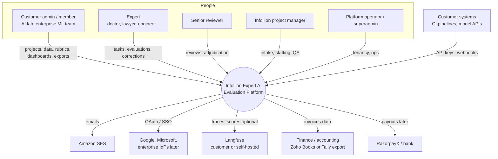
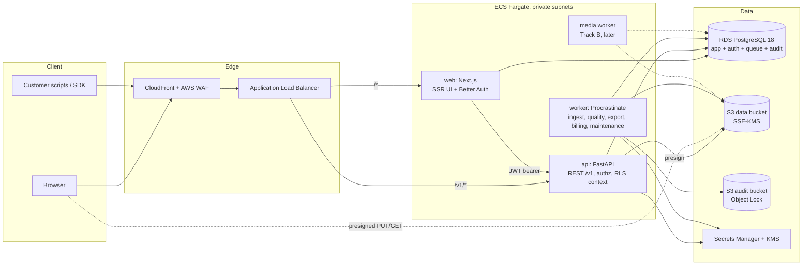
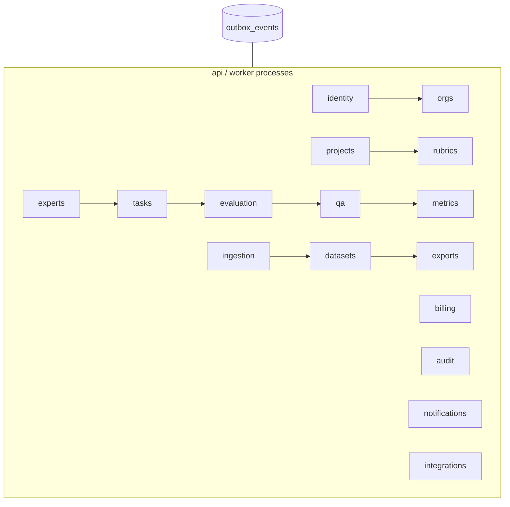

# System Architecture

> **Reconciliation note (2026-10-20):** Where this document differs from `planning/architecture_decisions.md`, the ADRs there are authoritative. In particular: Phase 1 authentication is FastAPI-native with MFA for every account (ADR-005), Langfuse and model connectors are Phase 3 (ADR-007), enterprise SSO is Phase 4, Track B is Phase 5 (ADR-015), and experts get assignment-scoped RLS (ADR-017).

Status: proposed for MVP (Track A) with Track B extension points. Date: 2026-10-20.
Security architecture is owned by the security agent (`security_architecture.md`); this document references it but does not replace it.

Documents in this set:
- [component_design.md](component_design.md): modules, boundaries, sequences
- [database_design.md](database_design.md): schema, constraints, RLS, storage metadata
- [api_design.md](api_design.md): endpoints, contracts, permissions, errors
- [data_pipeline.md](data_pipeline.md): jobs, events, ingestion, metrics, versioning, exports, Track B
- [deployment_architecture.md](deployment_architecture.md): environments, AWS topology, CI/CD, DR, observability
- Diagrams: [diagrams/system_context.mmd](diagrams/system_context.mmd), [diagrams/database_erd.mmd](diagrams/database_erd.mmd), [diagrams/workflow.mmd](diagrams/workflow.mmd)

---

## 1. Goals and quality attributes

| Attribute | Target (MVP) |
|---|---|
| Tenant isolation | No cross-tenant read or write possible through any API path; enforced in app and by Postgres RLS |
| Data integrity and provenance | Every delivered label traceable to submissions, experts (pseudonymous), rubric version and dataset version; published rubrics and frozen datasets immutable |
| Availability | 99.5% monthly for API and web (single region, Multi-AZ) |
| Durability / DR | RPO 5 min, RTO 4 h for regional loss; RPO ~0 and RTO < 5 min for AZ loss |
| Performance | p95 API < 300 ms for reads, < 800 ms for submission writes; ingestion of 100k rows < 10 min |
| Scale (year 1) | 50 customer orgs, 2,000 active experts, 30k submissions/day peak |
| Data residency | All customer data stored and processed in India (ap-south-1, DR ap-south-2) by default |
| Operability | Team of 3 to 5 engineers can run it; minimal stateful services to operate |
| Cost | Under USD 1,500/month infrastructure at MVP scale (section 8) |

---

## 2. System context

Source: [diagrams/system_context.mmd](diagrams/system_context.mmd).

---

## 3. Container view

| Container | Technology | Responsibility | Scaling |
|---|---|---|---|
| web | Next.js (App Router, TypeScript), Better Auth | UI for all roles, login/session/MFA/OAuth/SSO, server-side calls to API with short-lived JWT | stateless, 2+ tasks, CPU-based autoscaling |
| api | FastAPI, Uvicorn, SQLAlchemy 2.0 async, Pydantic v2 | all business APIs, authz, RLS context, presigning, outbox writes | stateless, 2+ tasks, CPU and p95 latency autoscaling |
| worker | Same image as api, `procrastinate worker` entrypoint | background jobs per queue | per-queue services; scale on queue depth (custom CloudWatch metric) |
| PostgreSQL | RDS PostgreSQL 18, Multi-AZ | system of record, job queue, audit log, Better Auth tables | vertical first, read replica for dashboards/analytics |
| Object storage | S3 (MinIO locally) | uploads, payloads, manifests, exports, evidence | n/a |
| Email | Amazon SES (ap-south-1) | transactional email | n/a |
| Observability | CloudWatch Logs, OpenTelemetry to Grafana Cloud or AWS X-Ray, Sentry | logs, traces, metrics, errors | n/a |

There is intentionally no Redis/Valkey and no message broker in MVP: the queue, outbox, rate-limit buckets and idempotency store are in Postgres. Valkey is added when measured load requires it (ADR-003 notes the trigger).

---

## 4. Logical architecture (modular monolith)

Modules communicate by direct calls to another module's `interface.py` for synchronous queries (e.g. tasks asks experts for eligibility) and by outbox events for side effects (e.g. evaluation -> qa, billing, metrics, notifications). See [component_design.md](component_design.md).

Why a modular monolith: one deployable, one database, transactional consistency across the evaluation workflow (submission + task state + outbox in one commit), and a small team. Module boundaries (import-linter, table ownership, event contracts) keep a later split possible: the most likely extractions are `media` (Track B, different runtime needs) and `metrics` (CPU-heavy batch).

---

## 5. Roles

| Role | Org kind | Summary |
|---|---|---|
| customer_admin | customer | manages org, members, API keys, billing view; full project control; approves deliverables |
| customer_member | customer | creates and manages projects, uploads data, drafts rubrics, views dashboards, exports |
| expert | platform | completes assigned tasks; manages own profile, credentials, availability, conflicts; sees own quality feedback and earnings |
| reviewer (senior) | platform | second review, rework review, adjudication (senior/principal tier), gold proposals |
| project_manager | platform | intake review, rubric sign-off, staffing, assignment approval, QA oversight, delivery |
| internal_org_admin ("org admin") | platform | manages internal staff and experts (vetting, tiers), rate cards, billing operations |
| platform_operator | platform | tenant operations, support, job monitoring; cross-tenant read only through audited paths |
| superadmin | platform | break-glass: role grants, impersonation, destructive operations; hardware MFA required |

Full matrix: [api_design.md section 2](api_design.md#2-roles-and-permission-matrix).

Key separations:
- Customers never see expert real identity by default (pseudonyms); experts never see customer identity by default (`blind_customer_identity`).
- Reviewers cannot review their own submissions; adjudicators cannot adjudicate tasks they annotated.
- PMs and reviewers access customer data only for projects they are staffed on.

---

## 6. Authentication and authorization (summary)

Decision (ADR-002): **Better Auth in the Next.js tier, FastAPI as resource server verifying Better Auth-issued JWTs via JWKS; authorization data (memberships, roles, staffing) owned by FastAPI.**

Options considered:

| Option | Pros | Cons |
|---|---|---|
| Better Auth (self-hosted library, Postgres) | Data stays in our DB in India; email/password, OAuth, 2FA, organization plugin, JWT plugin with JWKS (EdDSA, 15 min default), SSO plugin with OIDC and SAML 2.0 and org provisioning; no per-MAU fees. Auth.js is now part of Better Auth, so it is the maintained path in the Next.js ecosystem | TypeScript-side identity means two languages touch auth; we must maintain upgrades; self-service enterprise SSO dashboard is a paid offering |
| Auth.js | Familiar | Project now folded into Better Auth; new work should start on Better Auth |
| Keycloak | Full IdP, SAML/OIDC, fine-grained admin, self-hosted in India | Heavy JVM service to run, upgrade and secure; UX customisation effort; overkill for MVP |
| WorkOS | Excellent enterprise SSO/SCIM, quick | US-hosted identity data (residency question for Indian enterprise and government customers), per-connection pricing |
| Clerk | Fast DX, hosted UI | Hosted identity outside India, MAU pricing at expert scale, less control |
| FastAPI-native sessions (Authlib + own tables) | Single language | Rebuilding MFA, OAuth, account linking, SSO ourselves |

Flow: browser holds a Better Auth session cookie (HttpOnly, Secure, SameSite=Lax) on the web origin. Server components and route handlers obtain a JWT (15 min, `sub` = user id, `aud` = `infollion-api`) and call FastAPI. FastAPI verifies signature, `iss`, `aud`, `exp`, then resolves memberships from `app.memberships`. Org API keys for machine clients are handled by FastAPI directly. Enterprise SSO (phase 4) uses the Better Auth SSO plugin; if a customer requires SCIM or a broker, Keycloak can be added behind Better Auth as an OIDC provider without changing FastAPI.

Authorization: RBAC permissions plus relationship checks (own, staffed, assigned) in FastAPI; Postgres RLS as a second layer. Details in database_design.md section 6 and api_design.md section 2. Threat model, MFA policy, key management and DPDP compliance controls are in security_architecture.md.

---

## 7. Scaling strategy

| Stage | Load | Actions |
|---|---|---|
| MVP | < 50 orgs, < 2k experts, < 30k submissions/day | 2x api, 2x web, 1 to 3 worker services, RDS db.r7g.large Multi-AZ, no cache |
| Growth | 10x | RDS xlarge/2xlarge, read replica for dashboards and metrics reads, RDS Proxy or PgBouncer for connections, Valkey for rate limits and hot dashboard caches, separate `metrics` worker with more memory |
| Scale | 100x | Partition `scores`/`submissions` by org hash, move Procrastinate to a dedicated small Postgres or move queue to SQS/Temporal, move analytics to a warehouse (ClickHouse or Redshift Serverless fed by logical replication/CDC) |
| Track B | Large media | Separate media workers (CPU/GPU, ECS on EC2 or AWS Batch), S3 Intelligent-Tiering, CloudFront signed URLs for video playback, Temporal for media workflows |

Hot paths and how they scale:
- **Next task allocation**: indexed partial queue + `SKIP LOCKED`; contention bounded per project.
- **Dashboards**: read the latest `metric_runs` (precomputed), not raw scores.
- **Ingestion**: streaming parse + `COPY`; memory constant; parallelism by job.
- **Exports**: streaming cursor to multipart upload; no full materialisation in memory.

---

## 8. Cost and operations trade-offs

Indicative monthly cost for production in ap-south-1 at MVP scale (on-demand list prices, rounded; verify with AWS Pricing Calculator before budgeting):

| Item | Sizing | Approx USD/month |
|---|---|---|
| RDS PostgreSQL Multi-AZ | db.r7g.large, 200 GB gp3, 7-day PITR | 450 to 550 |
| ECS Fargate | web 2x(0.5 vCPU,1 GB), api 2x(1 vCPU,2 GB), workers 3x(1 vCPU,2 GB) | 200 to 280 |
| ALB + WAF | 1 ALB, managed rule groups | 50 to 80 |
| NAT Gateway | 2 AZ (or 1 to save cost in MVP) | 70 to 140 |
| S3 + KMS + requests | 1 to 2 TB | 30 to 70 |
| CloudWatch logs/metrics | moderate | 40 to 100 |
| SES, Secrets Manager, ECR, backups to ap-south-2 | | 30 to 80 |
| Sentry / Grafana Cloud | team plans | 0 to 100 |
| **Total** | | **roughly 900 to 1,400** |

Staging runs single-AZ, smaller RDS (db.t4g.medium), scaled to zero workers at night: roughly USD 200 to 300.

Trade-offs taken deliberately:
- Postgres as queue and audit store: fewer services and simpler backups, at the cost of putting more load on the primary. Mitigated by queue isolation and by moving the queue later if needed.
- Fargate over EKS: no cluster to operate; slightly higher per-vCPU cost and less flexibility for GPU work (Track B media will use EC2 capacity providers or AWS Batch).
- Better Auth over a hosted IdP: no per-MAU fees and Indian data residency, at the cost of owning auth upgrades.
- Single region with cross-region backups instead of active-active: far cheaper; RTO measured in hours for a regional outage, acceptable for an evaluation workflow platform.

---

## 9. Data residency options

| Option | Description | When |
|---|---|---|
| Default (India) | All data in ap-south-1, DR copies in ap-south-2; SES, KMS, Secrets in ap-south-1 | Indian and most global customers; aligns with DPDP Act expectations |
| Customer-region cell | Separate deployment (same images, IaC parameterised) in eu-central-1 or us-east-1 for customers with EU/US residency requirements; `organizations.data_region` routes signup to the right cell | When a contract requires it; a cell is a full stack, not a shared DB |
| Dedicated tenant | Single-tenant stack or dedicated RDS instance + per-org KMS key | Large enterprise or government |
| BYO bucket | Exports delivered to customer bucket via cross-account role | Phase 2 |

Third-party processors (Sentry, Grafana Cloud, email) must receive no customer content; logs scrub payloads and PII. Sentry can be pinned to its EU region or self-hosted if required.

---

## 10. ADR candidates (architecture-agent numbering; final numbered decisions are in planning/architecture_decisions.md)

| ADR | Decision | Status |
|---|---|---|
| ADR-001 | Modular monolith (FastAPI) + Next.js front end; no microservices for MVP | Proposed |
| ADR-002 | Better Auth in Next.js; FastAPI verifies JWT via JWKS; authorization owned by FastAPI | Proposed |
| ADR-003 | Procrastinate (Postgres) job queue + transactional outbox; no Redis in MVP; revisit at > 500 req/s or > 50 jobs/s sustained | Proposed |
| ADR-004 | Shared database, shared schema multi-tenancy with `org_id` everywhere, composite tenant FKs, and Postgres RLS (FORCE) as defense in depth | Proposed |
| ADR-005 | UUIDv7 primary keys on PostgreSQL 18 | Proposed |
| ADR-006 | Content-addressed dataset items with immutable version membership and manifests | Proposed |
| ADR-007 | Krippendorff's alpha as primary agreement metric; consensus thresholds per project; adjudication on disagreement | Proposed |
| ADR-008 | Presigned direct-to-S3 uploads/downloads with DB-tracked object metadata; no S3 listing in request paths | Proposed |
| ADR-009 | AWS ap-south-1 primary, ap-south-2 DR, ECS Fargate + RDS + S3; Terraform | Proposed |
| ADR-010 | Append-only audit log with hash chain anchored to S3 Object Lock | Proposed |
| ADR-011 | Pseudonymous expert identity toward customers; blind customer identity toward experts by default | Proposed |
| ADR-012 | Exporter and TaskType plugin registries as Track B extension mechanism; Temporal deferred to Track B media workflows | Proposed |
| ADR-013 | OpenAPI-first contract with generated TypeScript client | Proposed |
