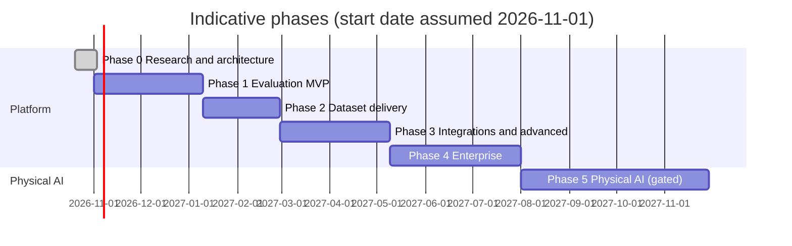

# Implementation Roadmap

Date: 2026-10-20

## Estimation assumptions

- Team: 2 full-stack engineers, 1 backend/data engineer, 0.5 designer, 1 project manager from Infollion operations, part-time security/legal counsel. Effort is expressed in engineer-weeks (ew).
- Estimates are ranges for planning, not commitments. They assume the architecture in `architecture/` is accepted unchanged and that no customer requires SSO or non-India residency before Phase 4.
- AI-assisted coding is assumed to speed scaffolding but not review, testing, or security work.
- Calendar time depends on staffing; the ranges below assume the team above working in parallel.

## Phase overview

## Phase 0: Research and architecture

- **Deliverables:** this folder.
- **Dependencies:** none.
- **Exit criteria:** stakeholders review executive summary, ADRs marked Proposed are confirmed, open questions OQ-01 to OQ-06 answered, counsel engaged on legal flags.
- **Effort:** 2 to 3 ew (done for the research portion).

## Phase 1: Evaluation MVP

- **Scope:** see `mvp_scope.md`.
- **Dependencies:** Phase 0 sign-off; one design-partner customer for the pilot; 10 to 30 experts in the pilot domain recruited from the Infollion network with signed NDA and IP assignment.
- **Milestones:**
  1. M1.1 Foundations: repo, Docker Compose, migrations, auth, orgs, roles, audit, RLS tests (3 to 5 ew).
  2. M1.2 Projects, rubrics, ingestion, dataset versions (3 to 5 ew).
  3. M1.3 Experts, matching, assignment, workbench, submissions (4 to 6 ew).
  4. M1.4 QA: gold, overlap agreement, adjudication, rework (3 to 4 ew).
  5. M1.5 Dashboards, JSONL exports, signed downloads, usage records (2 to 4 ew).
  6. M1.6 Hardening: security review, load test, staging, pilot run, per-tenant KMS keys and daily audit hash-chain anchoring to S3 Object Lock (required before production launch per security register; low cost on AWS) (2 to 4 ew).
- **Effort:** 17 to 28 ew.
- **Risks:** pilot customer slips; expert supply in niche domain; agreement lower than expected forcing rubric redesign.
- **Acceptance criteria:** MVP success criteria in `mvp_scope.md`; OWASP ASVS L2 items marked MVP in `architecture/security_architecture.md` pass.

## Phase 2: Dataset delivery

- **Scope:** dataset curation and freeze workflow, dataset diffing, red-team task type and safety taxonomy, ranking tasks (k > 2), Hugging Face `datasets` / Parquet export, TRL and OpenAI fine-tuning formats, quality certificate per batch, expert calibration program and tiering, payout report export, customer webhooks.
- **Dependencies:** Phase 1 in production; at least one customer requesting SFT or preference data.
- **Milestones:** M2.1 curation and freeze; M2.2 new task types; M2.3 export formats and certificates; M2.4 calibration and tiering.
- **Effort:** 12 to 18 ew.
- **Risks:** format drift in target training libraries; customers expecting data volume beyond expert capacity.
- **Acceptance criteria:** exports validate against published schemas and load with `datasets.load_dataset` and TRL preference loaders in CI; frozen versions cannot be modified; reproducible re-export yields identical hashes.

## Phase 3: Integrations and advanced evaluation

- **Scope:** model endpoint connectors (OpenAI-compatible API, customer-hosted endpoints) for repeatable runs; regression comparison between model versions; Langfuse adapter (traces in, scores out); opt-in LLM-as-a-judge pre-scoring with human calibration sets; Inspect AI integration for agent tasks and human baselining; Label Studio for image, audio, video; agent trajectory task type.
- **Dependencies:** ADR-014 opt-in controls; customer demand for ongoing monitoring.
- **Effort:** 16 to 26 ew.
- **Risks:** Langfuse self-host operations (ClickHouse); API changes in third-party tools; judge bias leading to false confidence.
- **Acceptance criteria:** a customer can register a new model version and re-run a frozen benchmark, view per-criterion regression with confidence intervals, and request human review on regressions; judge-human agreement reported for every judge.

## Phase 4: Enterprise capabilities

- **Scope:** SAML/OIDC SSO and SCIM, automated crypto-shredding workflow on tenant offboarding, customer-configurable retention, customer-facing audit log export, usage-based invoicing with GST, payouts integration, rate cards, SLA reporting, SOC 2 Type I readiness then Type II, ISO 27001 readiness, cross-region replica for RPO 5 min, optional dedicated database cell.
- **Dependencies:** first enterprise contract or security questionnaire requirements.
- **Effort:** 20 to 32 ew plus audit firm engagement.
- **Risks:** compliance timelines longer than sales cycles; cost of dedicated cells.
- **Acceptance criteria:** SSO login with at least two IdPs in staging; tenant key deletion renders tenant objects unreadable in test; DR drill meets RTO 4h, RPO 5 min.

## Phase 5: Physical AI expansion (gated)

- **Gate (all required):** paying Track A customers; a robotics customer co-funding a pilot; counsel sign-off on consent (including biometric data), worker welfare and cross-border transfer; hiring or contracting capture operations lead and robotics data engineer.
- **Scope:** first a partnered pilot (capture partner records, Infollion supplies skilled workers, segmentation and QA); then capture kits (head-mounted cameras, optional depth and hand tracking), media pipeline, consent records, redaction, LeRobot / RLDS / HDF5 exporters.
- **Effort:** 20 to 40 ew plus hardware and field operations budget (to be costed after partner discussions).
- **Acceptance criteria:** pilot dataset passes customer QA, every episode links to a valid consent record and redaction log, exports load with LeRobot tooling.
