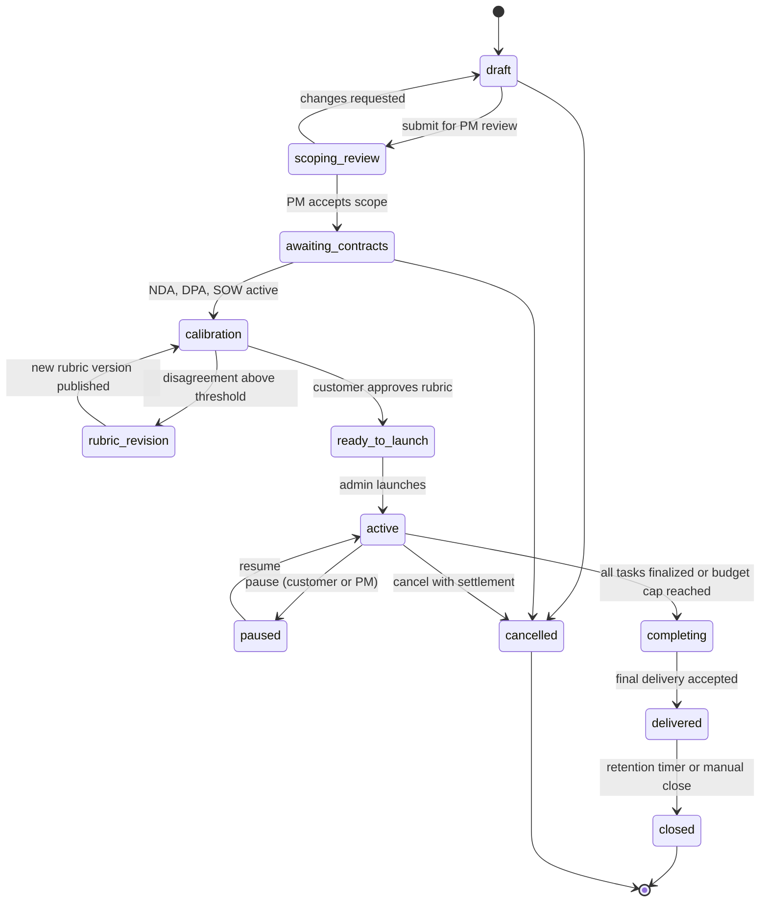
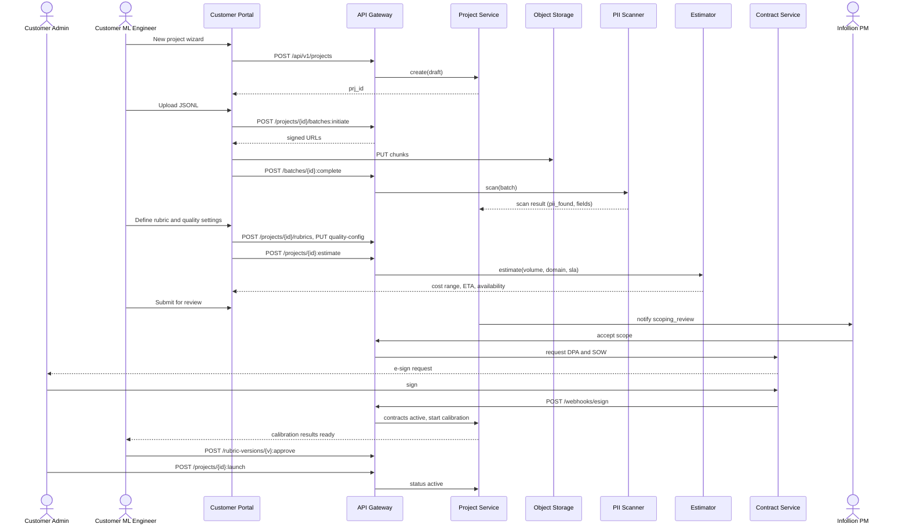
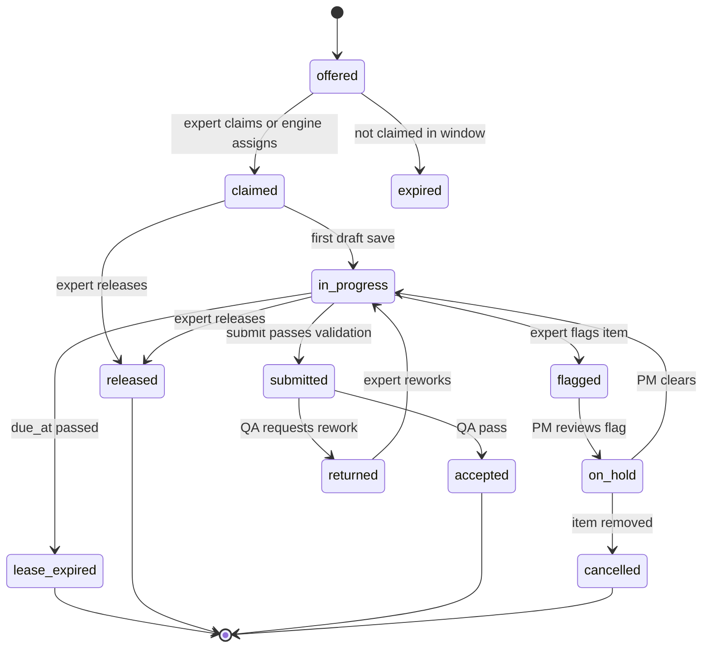
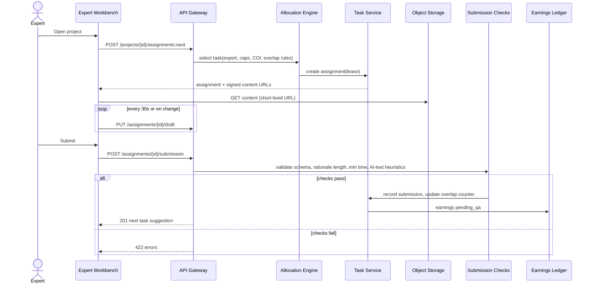
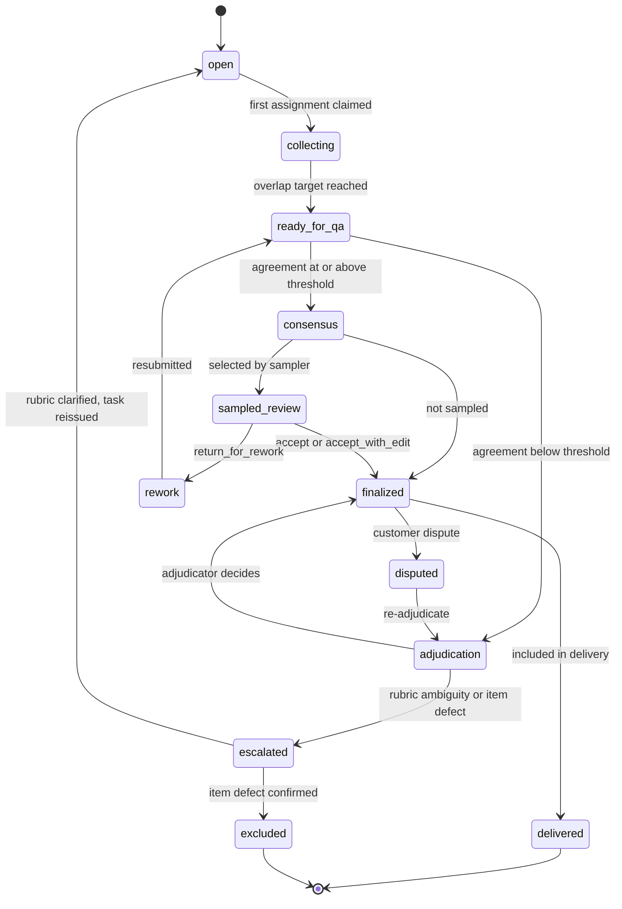
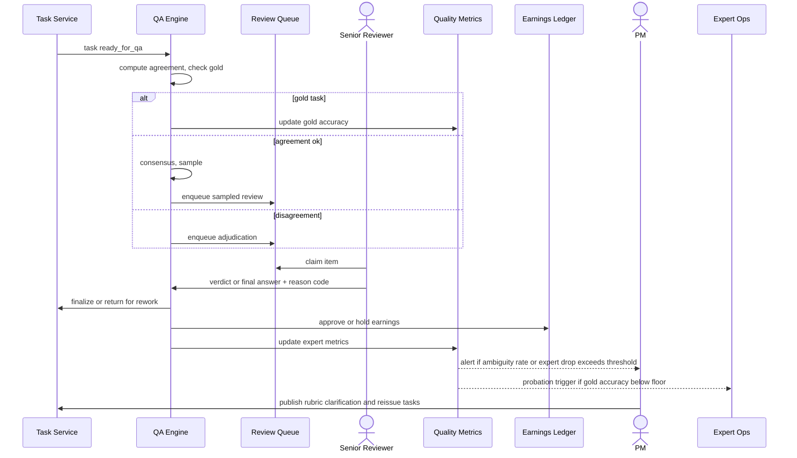
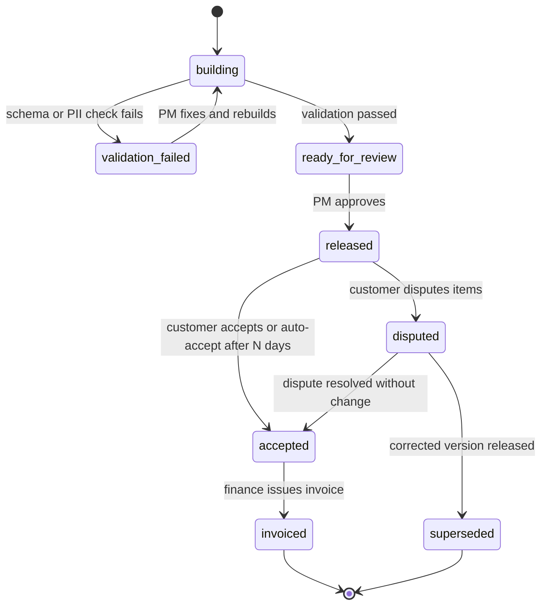
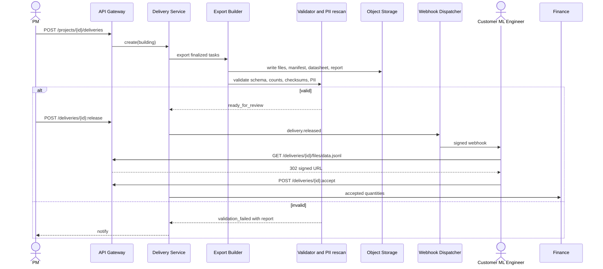
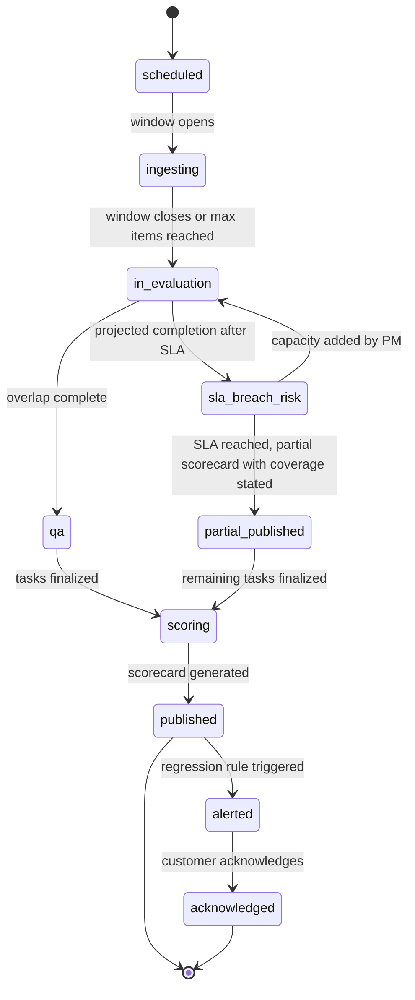
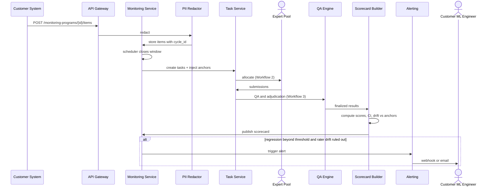

# Core Product Workflows

Prepared by: Product & Operations Agent
Date: 2026-10-20
Related: `user_personas_and_roles.md` (roles and permissions), `../research/market_and_business_model.md` (packages), `../agents/operations_agent_findings.md` (ops design).

Conventions:
- REST API base path `/api/v1`. JSON bodies. Auth via OAuth2/OIDC session (UI) or org-scoped API key (customer API). Idempotency via `Idempotency-Key` header on all POSTs that create resources.
- IDs are prefixed ULIDs (`prj_`, `itm_`, `tsk_`, `asg_`, `sub_`, `rev_`, `adj_`, `dlv_`, `exp_`, `rub_`).
- All timestamps UTC ISO 8601.
- Errors follow RFC 9457 problem+json: `{type, title, status, detail, instance, errors[]}`.
- Audit events are append-only, written to `audit_events` with `actor_id, actor_role, org_id, project_id, event_type, target_type, target_id, before, after, ip, user_agent, request_id, created_at`. Content payloads are never written into audit records; only IDs and hashes.
- Table names below are indicative; the architecture agent owns the final schema.

Core entities used by all workflows:

| Entity | Key fields |
|---|---|
| organizations | id, name, type (customer / internal), data_region, retention_days |
| projects | id, org_id, package_type, status, sla_hours, budget_cap, pricing_model, blind_customer, created_by |
| project_contracts | project_id, nda_id, dpa_id, sow_id, status, effective_dates |
| rubrics / rubric_versions | rubric_id, version, schema_json (dimensions, scales, required rationale), status, published_by |
| items | id, project_id, batch_id, payload_ref (object storage URI), content_hash, pii_status, status |
| tasks | id, item_id, task_type (rate, compare, write, review, adjudicate), required_overlap, is_gold, status |
| assignments | id, task_id, expert_id, status, claimed_at, due_at, submitted_at |
| submissions | id, assignment_id, rubric_version_id, answer_json, rationale, time_spent_s, client_meta |
| reviews | id, submission_id, reviewer_id, verdict, scores, feedback |
| adjudications | id, task_id, adjudicator_id, final_answer_json, reason_code |
| quality_metrics | project_id, expert_id, window, gold_accuracy, agreement, review_pass_rate |
| deliveries | id, project_id, version, manifest_ref, schema_version, status, checksum |
| experts / expert_qualifications | expert_id, tier, domains, verification_status, project qualifications, scores |
| earnings_ledger | expert_id, assignment_id, amount, currency, status, payout_batch_id |

---

## Workflow 1: Customer creates an evaluation project

### 1.1 Actors and permissions
| Actor | Permissions used |
|---|---|
| Customer Admin | `project:create`, `project:approve_launch`, `data:set_retention` |
| Customer ML Engineer | `project:edit_draft`, `items:upload`, `rubric:propose` |
| PM (Infollion) | `project:configure`, `rubric:publish`, `qa:configure`, `pool:invite` |
| Ops/Finance | `ratecard:manage` (pricing approval) |
| System | PII scanner, contract checker, cost estimator |

### 1.2 Preconditions
- Customer org exists with at least one Admin; NDA signed (org-level). DPA and SOW may be per project.

### 1.3 UI screens
1. **Projects list** (customer portal): status chips, budget burn, SLA.
2. **New project wizard**:
   - Step 1 Basics: name, package type (evaluation, preference, SFT, benchmark, red-team, agent eval, monitoring), domain(s), language(s).
   - Step 2 Data: upload CSV/JSONL/Parquet or connect bucket; field mapping; PII scan result.
   - Step 3 Rubric: pick template or build (dimensions, scale, anchors with examples, rationale required yes/no).
   - Step 4 Quality settings (PM can edit; customer sees defaults): overlap %, gold %, review %, agreement target.
   - Step 5 Volume, SLA, budget: estimated cost and turnaround from estimator.
   - Step 6 Compliance: data region, retention, blind-customer flag, DPA/SOW attach or request.
   - Step 7 Review and submit for calibration.
3. **Calibration results** screen: per-item expert scores, disagreements, rubric comment threads, "approve rubric" button.
4. **Launch approval** modal (Admin).

### 1.4 API calls
| Step | Call | Notes |
|---|---|---|
| Create draft | `POST /api/v1/projects` | body: name, package_type, domains, languages |
| Update draft | `PATCH /api/v1/projects/{project_id}` | |
| Upload batch (small) | `POST /api/v1/projects/{project_id}/batches` (multipart) | returns `batch_id` |
| Upload batch (large) | `POST /api/v1/projects/{project_id}/batches:initiate` then signed PUT URLs, then `POST /api/v1/batches/{batch_id}:complete` | |
| Field mapping | `PUT /api/v1/batches/{batch_id}/mapping` | |
| PII scan status | `GET /api/v1/batches/{batch_id}/scan` | |
| Rubric draft | `POST /api/v1/projects/{project_id}/rubrics` ; `POST /api/v1/rubrics/{rubric_id}/versions` | |
| Quality config | `PUT /api/v1/projects/{project_id}/quality-config` | PM only for non-default |
| Estimate | `POST /api/v1/projects/{project_id}:estimate` | returns cost range, ETA, expert availability |
| Contracts | `POST /api/v1/projects/{project_id}/contracts` ; `GET .../contracts` | e-sign integration callback `POST /api/v1/webhooks/esign` |
| Submit for calibration | `POST /api/v1/projects/{project_id}:submit-calibration` | creates calibration task set |
| Approve rubric | `POST /api/v1/rubric-versions/{version_id}:approve` | customer side |
| Publish rubric | `POST /api/v1/rubric-versions/{version_id}:publish` | PM side, locks version |
| Approve launch | `POST /api/v1/projects/{project_id}:launch` | Admin; requires contracts active |
| Pause / resume / cancel | `POST /api/v1/projects/{project_id}:pause` / `:resume` / `:cancel` | |

### 1.5 Database changes
- `projects` insert (status `draft`), updates through lifecycle.
- `batches`, `items` inserts; `items.content_hash` computed; payloads stored in object storage under org/project prefix with region tag.
- `rubrics`, `rubric_versions` inserts; published versions immutable.
- `project_quality_configs` upsert.
- `project_contracts` insert/update via e-sign webhook.
- `tasks` inserts for calibration subset (`phase = calibration`).
- `project_estimates` insert (snapshot for audit).

### 1.6 State transitions

### 1.7 Sequence diagram

### 1.8 Validation rules
- Name unique within org; package_type in enum; at least one domain.
- Batch: file size limit per upload (configurable, for example 5 GB via multipart); schema must map required fields (`prompt`, `response` or package-specific); max item payload size; UTF-8; duplicate `content_hash` flagged.
- PII: if scan finds direct identifiers and the DPA does not permit PII processing, block calibration until customer redacts or approves redaction.
- Rubric: at least one dimension; every scale point has an anchor description; if `rationale_required`, min length set.
- Quality config: overlap 0-100%, gold 0-30%, review 0-100%; gold items must exist if gold > 0 (minimum 20 gold items or 5% of batch, whichever greater, configurable).
- Launch requires: contracts `active`, rubric version `published` and customer-approved, budget cap set, estimated qualified expert capacity at least SLA throughput.
- Data region of storage must equal org data_region.

### 1.9 Error handling
| Condition | HTTP | Behaviour |
|---|---|---|
| Missing permission | 403 | problem+json `forbidden` |
| Validation failure | 422 | per-field errors |
| Duplicate idempotency key with different body | 409 | |
| Upload incomplete or checksum mismatch | 409 | batch stays `uploading`; resumable |
| PII blocked | 422 `pii_blocked` | UI offers redaction options |
| Contracts not active on launch | 409 `contracts_inactive` | |
| Insufficient expert capacity | 200 with warning on estimate; 409 on launch unless override by PM with reason | |
| Estimator unavailable | 503 | retry with backoff; wizard can save draft |

### 1.10 Audit events
`project.created`, `project.updated`, `batch.uploaded`, `batch.pii_scanned`, `rubric.version_created`, `rubric.version_published`, `rubric.version_approved`, `quality_config.changed`, `estimate.generated`, `contract.requested`, `contract.signed`, `project.calibration_started`, `project.launched`, `project.paused`, `project.resumed`, `project.cancelled`.

### 1.11 Quality checks
- Calibration batch (20-50 items) rated by 3-5 experts each; compute agreement per dimension; PM and customer review items with low agreement; iterate rubric until agreement target met (for example Krippendorff alpha at least 0.67 on ordinal dimensions, or customer-approved threshold).
- Gold items drafted from calibration consensus plus customer key.

### 1.12 Acceptance criteria
- A customer can go from draft to `active` without Infollion engineering intervention, with PM approval only.
- Every task created references a published rubric version.
- Launch is impossible without active contracts and approved rubric (enforced server-side).
- Estimate is stored and shown alongside final invoice for variance tracking.
- All listed audit events are emitted and queryable by project.

---

## Workflow 2: Expert evaluates outputs

### 2.1 Actors and permissions
| Actor | Permissions used |
|---|---|
| Expert | `task:claim`, `task:submit`, `task:flag`, `coi:declare` |
| PM | `pool:invite`, `allocation:configure`, `expert:pause` |
| System | Allocation engine, timer service, AI-assist checks |

### 2.2 Preconditions
- Expert verified, tier assigned, project qualification passed (screening plus calibration), project confidentiality addendum accepted, no COI with customer org.

### 2.3 UI screens
1. **Expert home**: invitations, available projects, earnings, quality score, workload this week.
2. **Project onboarding**: guidelines, rubric with examples, confidentiality addendum, qualification quiz.
3. **Task workbench**: prompt and response(s) panel, rubric form (per dimension), rationale box, flag menu (PII found, harmful content, unclear rubric, out of expertise), timer (informational), keyboard shortcuts, autosave.
4. **Feedback inbox**: reviewer feedback, gold results, rubric clarifications.
5. **Earnings**: per-task ledger, payout status, tax documents.

### 2.4 API calls
| Step | Call |
|---|---|
| List invitations | `GET /api/v1/me/invitations` |
| Accept invitation and addendum | `POST /api/v1/invitations/{id}:accept` |
| Declare COI | `POST /api/v1/me/coi-declarations` |
| Qualification attempt | `POST /api/v1/projects/{project_id}/qualification-attempts` ; `POST /api/v1/qualification-attempts/{id}:submit` |
| Request next task | `POST /api/v1/projects/{project_id}/assignments:next` |
| Get task | `GET /api/v1/assignments/{assignment_id}` (returns signed short-lived content URLs) |
| Autosave | `PUT /api/v1/assignments/{assignment_id}/draft` |
| Submit | `POST /api/v1/assignments/{assignment_id}/submission` |
| Flag / skip | `POST /api/v1/assignments/{assignment_id}:flag` ; `POST /api/v1/assignments/{assignment_id}:release` |
| Feedback | `GET /api/v1/me/feedback` |
| Earnings | `GET /api/v1/me/earnings?period=` |

### 2.5 Database changes
- `assignments` insert on claim (status `claimed`, `due_at` = now + lease, for example 60 min, configurable per task type).
- `assignment_drafts` upsert (encrypted at rest).
- `submissions` insert; `assignments.status = submitted`; `tasks.received_count++`.
- If `task.received_count == required_overlap`: `tasks.status = ready_for_qa`.
- `earnings_ledger` insert status `pending_qa` (becomes `approved` after QA, or `reduced/void` per policy).
- `flags` insert on flag; task may move to `on_hold`.
- `expert_workload` counters updated.

### 2.6 State transitions (assignment)

### 2.7 Sequence diagram

### 2.8 Validation rules
- Expert must hold active qualification for project and rubric version; rubric version on submission must equal the task's published version.
- Allocation: expert never receives the same item twice in overlap; gold items indistinguishable from normal items; COI exclusion by customer org, named entities in item metadata, and declared employers; workload caps (daily and weekly hours, configurable, for example 6h/day, 30h/week default) enforced.
- Submission: all required dimensions answered; rationale meets min length; `time_spent_s` above minimum plausible threshold (per task type) else flagged "too fast" (accepted but routed to 100% review); paste-detection and AI-generated text heuristics produce a risk score, not an automatic rejection.
- Lease: submission after lease expiry rejected unless task still open and not reassigned (then accepted with a flag).

### 2.9 Error handling
| Condition | HTTP | Behaviour |
|---|---|---|
| No eligible task | 204 | UI shows "no tasks available, notify me" |
| Workload cap reached | 429 `workload_cap` | message with reset time |
| Lease expired | 409 `lease_expired` | draft retained for 24h for reference only |
| Rubric version changed mid-task | 409 `rubric_changed` | draft migrated if compatible, else task reissued |
| Content URL expired | 401 from storage | workbench refetches assignment |
| Network loss | n/a | local draft cache, retry submit with same Idempotency-Key |

### 2.10 Audit events
`invitation.accepted`, `addendum.accepted`, `coi.declared`, `qualification.attempted`, `qualification.passed/failed`, `assignment.claimed`, `assignment.released`, `assignment.lease_expired`, `assignment.flagged`, `submission.created`, `content.accessed` (item ID, expert ID, timestamp; used for leakage investigations).

### 2.11 Quality checks
- Gold items injected at configured ratio; rolling gold accuracy per expert.
- Time-on-task anomalies; straight-lining detection (same score everywhere).
- Inter-rater agreement on overlapped items.
- Wellbeing: for red-team or harmful content projects, content warnings, exposure time caps and opt-out without penalty.

### 2.12 Acceptance criteria
- An eligible expert receives a task within 2 seconds of request when tasks exist (p95).
- No expert is ever assigned an item from an org with which they have a declared or detected COI (verified by automated test).
- Drafts survive browser refresh and short network loss.
- Workload caps enforced server-side.
- Every submission is linked to rubric version, expert ID, time spent and client metadata.

---

## Workflow 3: QA and adjudication

### 3.1 Actors and permissions
| Actor | Permissions used |
|---|---|
| Senior Reviewer | `review:perform`, `adjudication:resolve`, `gold:propose`, `expert:score` |
| PM | `qa:configure`, `escalation:manage`, override adjudication |
| Customer ML Engineer | `feedback:submit` (disputes on delivered items) |
| Vetting / Expert Ops | `expert:tier_change`, `expert:suspend` |
| System | Agreement calculator, sampler, LLM-assisted pre-review (optional, advisory only) |

### 3.2 QA logic
1. When a task reaches `ready_for_qa`:
   - Compute agreement across overlapped submissions.
   - If task is gold: score each submission against key, update expert gold accuracy; gold tasks are not delivered.
   - If overlap agreement passes threshold: auto-consensus (majority or mean per dimension as configured), then sampled for review at `review_rate`.
   - If disagreement: route to adjudication queue.
   - If single-rated task: sampled review at `review_rate`; 100% review for experts in probation or with risk flags.
2. Review verdicts: `accept`, `accept_with_edit` (reviewer corrects), `return_for_rework` (with feedback), `reject` (unusable; triggers reassignment).
3. Adjudication: senior reviewer sees all submissions blind to expert identity, plus rationales and gold context, and records the final answer and a reason code (`rubric_ambiguity`, `expert_error`, `item_defect`, `genuine_subjectivity`).
4. Escalation: if adjudicator marks `rubric_ambiguity` above a threshold rate (for example 5% of a batch), PM is alerted to issue a rubric clarification or new version; if `item_defect`, item moves to `excluded` with customer notification.

### 3.3 UI screens
1. **Review queue** with filters (project, reason, expert risk, age, SLA).
2. **Side-by-side review**: item, submissions, rationales, agreement metrics, gold key if any, verdict buttons, feedback templates.
3. **Adjudication console**: blind submissions, final answer form, reason code, "propose as gold" toggle.
4. **Expert quality dashboard** (PM, Vetting): gold accuracy, agreement with consensus, review pass rate, trend, probation status.
5. **Escalations board** (PM): rubric ambiguity clusters, flagged items, customer disputes.

### 3.4 API calls
| Step | Call |
|---|---|
| Get review queue | `GET /api/v1/review-queue?project_id=&type=review|adjudication` |
| Claim review | `POST /api/v1/review-queue/{task_id}:claim` |
| Submit review | `POST /api/v1/submissions/{submission_id}/reviews` |
| Submit adjudication | `POST /api/v1/tasks/{task_id}/adjudications` |
| Propose gold | `POST /api/v1/projects/{project_id}/gold-items` |
| Rubric clarification | `POST /api/v1/rubrics/{rubric_id}/clarifications` |
| Escalate | `POST /api/v1/escalations` ; `PATCH /api/v1/escalations/{id}` |
| Expert metrics | `GET /api/v1/projects/{project_id}/experts/{expert_id}/quality` |
| Probation / suspend | `POST /api/v1/experts/{expert_id}:probation` ; `POST /api/v1/experts/{expert_id}:suspend` |
| Customer dispute | `POST /api/v1/deliveries/{delivery_id}/disputes` |

### 3.5 Database changes
- `reviews` insert; `submissions.qa_status` updated.
- `adjudications` insert; `tasks.final_answer_json` set; `tasks.status = finalized`.
- `quality_metrics` rolling windows recomputed (stream or scheduled job).
- `earnings_ledger` transitions: `pending_qa` to `approved` (accept), `approved` with adjustment policy for `accept_with_edit` (paid in full by default), `on_rework` (return), `void` only for `reject` with documented reason (policy flagged for HR/legal review to avoid unfair non-payment disputes like those alleged in S23 of the market file).
- `gold_items` insert after PM approval.
- `escalations` insert/update.
- `expert_status_history` insert on probation/suspension.

### 3.6 State transitions (task)

### 3.7 Sequence diagram

### 3.8 Validation rules
- Reviewer cannot review own submission or any submission on an item they rated.
- Adjudicator must be a different person from all raters on the task and at Tier 3 or above (configurable).
- Reason code mandatory for adjudication; feedback text mandatory for `return_for_rework` and `reject`.
- Max rework cycles per task (default 2) then auto-escalate.
- Gold item creation requires two senior agreements or customer key.
- Suspension requires PM or Vetting plus a second approver for network-level removal.

### 3.9 Error handling
| Condition | HTTP | Behaviour |
|---|---|---|
| Review already claimed | 409 | return next item |
| Conflict of interest for reviewer | 403 `coi_conflict` | excluded from queue automatically; error only on direct link |
| Rework limit exceeded | 409 | auto-escalate |
| Metrics job lag | n/a | dashboards show staleness timestamp; alerts if lag over 15 min |

### 3.10 Audit events
`review.created`, `adjudication.created`, `task.finalized`, `task.returned`, `task.excluded`, `gold.created`, `rubric.clarification_published`, `escalation.opened/resolved`, `expert.probation_started`, `expert.suspended`, `expert.reinstated`, `earnings.adjusted`, `dispute.opened/resolved`.

### 3.11 Quality checks and thresholds (initial defaults, tune per project)
| Metric | Default | Action |
|---|---|---|
| Expert gold accuracy (rolling 50 gold) | at least 85% | below 85%: probation and 100% review; below 70%: removed from project |
| Review pass rate | at least 90% | below: coaching, then probation |
| Item-level agreement | project target (for example alpha at least 0.67) | below: adjudication |
| Rubric ambiguity rate | under 5% per batch | above: PM rubric clarification |
| Rework rate | under 10% | above: PM investigates instructions |

### 3.12 Acceptance criteria
- Every finalized task has either consensus or adjudication record, never neither.
- Reviewers and adjudicators are never the original raters (enforced and tested).
- Expert metrics update within 15 minutes of QA events.
- Each rejection or rework carries written feedback visible to the expert.
- Probation and suspension are reversible with history preserved.

---

## Workflow 4: Deliver training-ready data

### 4.1 Actors and permissions
| Actor | Permissions used |
|---|---|
| PM | `delivery:approve` |
| Customer Admin / ML Engineer | `results:view`, `results:export`, `feedback:submit` |
| System | Export builder, schema validator, PII re-scan, checksum, webhook dispatcher |

### 4.2 Delivery contents
- Data files: JSONL and Parquet (configurable), one record per item with final labels, per-dimension scores, rationale (optional), consensus method, agreement statistics, rubric_version_id, pseudonymous rater IDs (optional, per SOW), timestamps.
- Package-specific formats: preference pairs (`chosen`, `rejected`, `margin`) compatible with common DPO/RLHF loaders; SFT (`messages` chat format); benchmark (`question`, `reference_answer`, `grading_rubric`, metadata).
- `manifest.json`: file list, row counts, SHA-256 checksums, schema version, project and delivery IDs.
- `datasheet.md` / `dataset_card`: purpose, collection process, expert profile summary (aggregated, no personal data), QA methodology, metrics, known limitations, licence/IP terms.
- `quality_report.pdf/html`: agreement, gold accuracy, error taxonomy, exclusion list with reasons.

### 4.3 UI screens
1. **Deliveries** list: version, status, row counts, created, download, webhook status.
2. **Delivery preview**: sample records, schema, metrics, diff vs previous version.
3. **Acceptance** screen: accept or dispute (per item or batch) with reasons.
4. **PM delivery builder**: select finalized tasks or batch range, choose format, run validation, approve.

### 4.4 API calls
| Step | Call |
|---|---|
| Create delivery (PM) | `POST /api/v1/projects/{project_id}/deliveries` body: scope (batches, date range), formats, include_rationales |
| Build status | `GET /api/v1/deliveries/{delivery_id}` |
| Approve and release | `POST /api/v1/deliveries/{delivery_id}:release` |
| List deliveries (customer) | `GET /api/v1/projects/{project_id}/deliveries` |
| Download | `GET /api/v1/deliveries/{delivery_id}/files/{file}` returns 302 to signed URL (TTL 15 min) |
| Streaming results (incremental) | `GET /api/v1/projects/{project_id}/results?since=cursor` |
| Accept | `POST /api/v1/deliveries/{delivery_id}:accept` |
| Dispute | `POST /api/v1/deliveries/{delivery_id}/disputes` |
| Webhooks | `POST {customer_url}` event `delivery.released` signed with HMAC; manage via `POST /api/v1/webhooks` |
| Push to customer bucket (optional) | `POST /api/v1/deliveries/{delivery_id}:push` (S3/GCS/Azure with customer-provided role) |

### 4.5 Database changes
- `deliveries` insert (status `building`); `delivery_items` join rows (delivery_id, task_id, record_hash).
- `tasks.status = delivered` on release.
- `delivery_files` with storage URI, checksum, size.
- `delivery_acceptances` / `disputes` inserts.
- `invoices` draft line items generated from accepted delivery quantities (Finance).

### 4.6 State transitions (delivery)

### 4.7 Sequence diagram

### 4.8 Validation rules
- Only `finalized` tasks; gold tasks excluded; excluded items listed with reason.
- Schema validated against versioned JSON Schema for the package; row count equals delivery_items count; checksums computed and verified after upload.
- PII re-scan on outputs (expert rationales may introduce names or identifiers); block if found unless DPA allows.
- Rater identity fields only pseudonymous unless SOW flag `rater_identity_disclosed` and expert consent recorded.
- Licence/IP clause in datasheet must match SOW.

### 4.9 Error handling
| Condition | Behaviour |
|---|---|
| Export job failure | retry 3x with backoff; then `validation_failed` with error log |
| Webhook delivery failure | exponential retry for 24h; dead-letter; visible in UI |
| Signed URL expired | client re-requests file endpoint |
| Customer push fails (permissions) | 424 `push_failed` with remediation hint; files remain downloadable |

### 4.10 Audit events
`delivery.created`, `delivery.validated`, `delivery.validation_failed`, `delivery.released`, `delivery.file_downloaded` (user, file, IP), `delivery.pushed`, `delivery.accepted`, `delivery.disputed`, `delivery.superseded`, `invoice.drafted`.

### 4.11 Quality checks
- Final delivery-level metrics meet SOW thresholds (agreement, gold accuracy aggregate, review pass rate); if not, PM must document variance before release.
- Random 2% "delivery audit" sample re-reviewed by a different senior reviewer before first delivery on any project.

### 4.12 Acceptance criteria
- Customer can load the delivered JSONL into a standard loader with zero schema errors.
- Manifest checksums verify.
- Datasheet and quality report present in every delivery.
- Every download is logged.
- A dispute creates linked re-adjudication tasks and a superseding version without overwriting the original.

---

## Workflow 5: Ongoing evaluation (monitoring)

### 5.1 Actors and permissions
| Actor | Permissions used |
|---|---|
| Customer ML Engineer | `items:upload` via API, `results:view`, `webhook:manage` |
| Customer Admin | subscription management, `billing:view` |
| PM | monitor pool continuity, anchors, SLAs |
| Experts (stable pool) | normal Workflow 2 permissions |
| System | Scheduler, sampler, anchor injector, drift detector, alerting |

### 5.2 Concept
A **monitoring program** is a recurring project with cycles (daily, weekly, per model release). Each cycle ingests new items (sampled production traffic or a fixed suite run against a new model version), mixes in **anchor items** (fixed items rated every cycle to separate rater drift from model drift), runs Workflows 2 to 4 under an SLA, and publishes a **scorecard** with trends and regression alerts.

### 5.3 UI screens
1. **Program overview**: cycles timeline, current SLA status, model versions compared.
2. **Scorecard**: per-dimension scores by model version and cycle, confidence intervals, error taxonomy trends, top regressions with example items.
3. **Alerts settings**: thresholds per dimension, channels (email, webhook, Slack via webhook).
4. **Ingestion settings**: API key, sampling rate, PII redaction mode, max items per cycle (budget guard).

### 5.4 API calls
| Step | Call |
|---|---|
| Create program | `POST /api/v1/monitoring-programs` (base project, cadence, sla_hours, max_items_per_cycle, anchor_set_id) |
| Ingest items | `POST /api/v1/monitoring-programs/{program_id}/items` (batch up to N, includes `model_version`, `trace_id`) |
| Start cycle (manual or by schedule) | `POST /api/v1/monitoring-programs/{program_id}/cycles` |
| Cycle status | `GET /api/v1/cycles/{cycle_id}` |
| Scorecard | `GET /api/v1/monitoring-programs/{program_id}/scorecards?from=&to=&model_version=` |
| Alerts config | `PUT /api/v1/monitoring-programs/{program_id}/alert-rules` |
| Pause program | `POST /api/v1/monitoring-programs/{program_id}:pause` |

### 5.5 Database changes
- `monitoring_programs` insert; `program_cycles` insert per cycle; items linked with `cycle_id`, `model_version`.
- `anchor_sets` and `anchor_results` (per cycle, per expert) for drift.
- `scorecards` materialized per cycle; `alerts` inserts when rules trigger.
- `usage_records` per cycle for subscription billing and overage.

### 5.6 State transitions (cycle)

### 5.7 Sequence diagram

### 5.8 Validation rules
- Items must carry `model_version`; max items per cycle enforced (budget guard); duplicate `trace_id` rejected.
- PII redaction mandatory for production traffic unless DPA explicitly permits raw processing; redaction confidence below threshold routes item to manual redaction or exclusion.
- Anchor set size at least 20 items (configurable) and rated by at least 3 pool members each cycle.
- Regression alert fires only if (a) change exceeds threshold, (b) confidence interval excludes zero change, (c) anchor drift below rater-drift threshold. Otherwise publish with a "rater drift suspected" note and alert PM, not customer.

### 5.9 Error handling
| Condition | Behaviour |
|---|---|
| Ingest over quota | 429 `cycle_quota_exceeded`; items rejected with count |
| Pool capacity shortfall | `sla_breach_risk`; PM pages backup experts; customer notified if breach likely |
| Redaction failure | item quarantined; never shown to experts |
| Scorecard build failure | retry; cycle stays `scoring`; alert ops |

### 5.10 Audit events
`program.created`, `program.paused`, `cycle.started`, `cycle.items_ingested` (counts only), `cycle.sla_risk`, `cycle.published`, `alert.triggered`, `alert.acknowledged`, `anchor.drift_detected`, `usage.recorded`.

### 5.11 Quality checks
- Anchor-based rater drift per expert and pool.
- Pool continuity target: at least 70% of cycle volume rated by experts who rated the previous cycle (reduces noise).
- Coverage: each scorecard states sample size and CI per dimension.

### 5.12 Acceptance criteria
- Customer can push items via API and receive a scorecard within the SLA for at least 95% of cycles.
- Scorecards distinguish model regressions from rater drift using anchors.
- No unredacted production PII reaches the expert workbench (automated tests with seeded PII).
- Usage records reconcile to invoice line items.

---

## Cross-workflow non-functional requirements
- Data residency per org; India region default for Indian customers, configurable.
- Encryption at rest and in transit; signed short-lived URLs for content.
- Watermarking or per-expert content fingerprints optional for high-sensitivity projects (leak tracing).
- Accessibility: workbench keyboard-first, WCAG 2.1 AA target.
- Observability: per-project dashboards for throughput, queue age, SLA, cost burn.
